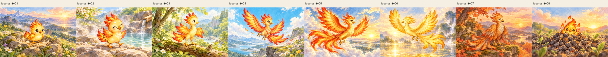
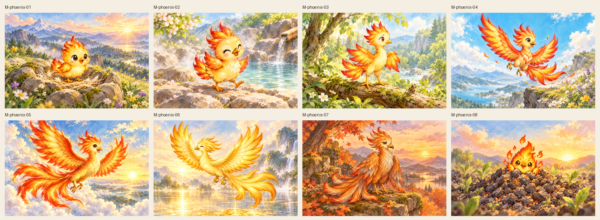
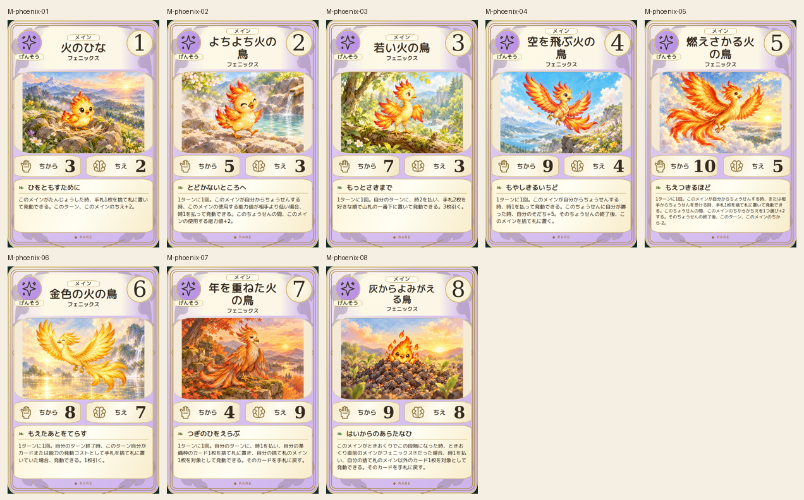
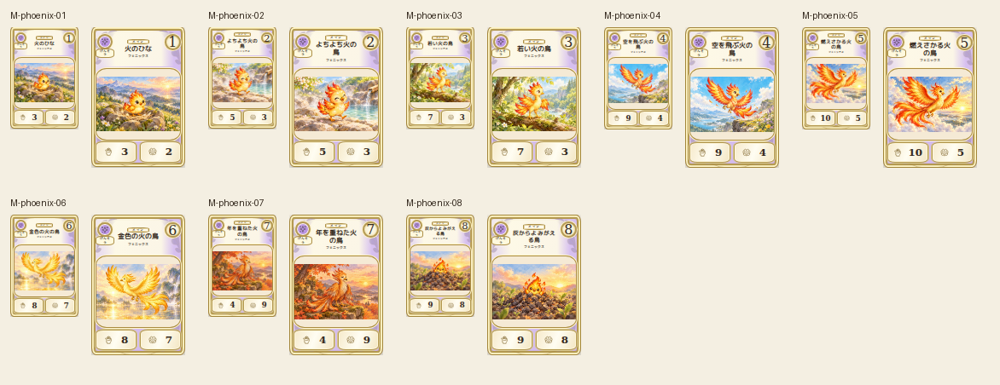

# main-phoenix-20261019

Canonical firebird life cycle compared: tiny chick, waddling young, balanced juvenile, first takeoff, flaming long-tail adult, entirely golden bird, subdued older bird and rebirth chick in ash. Tail length, wing scale, age palette and scenery differentiated. Bird anatomy and gentle fire treatment inspected.

完成ID: M-phoenix-01, M-phoenix-02, M-phoenix-03, M-phoenix-04, M-phoenix-05, M-phoenix-06, M-phoenix-07, M-phoenix-08

Chromium幅320/390/430、本文・数値、4サイズPNG検証済み。iPhone実機Safari未確認。既存46枚の184ファイル変更なし。ゲーム本体への組み込み・mainマージ未実施。
