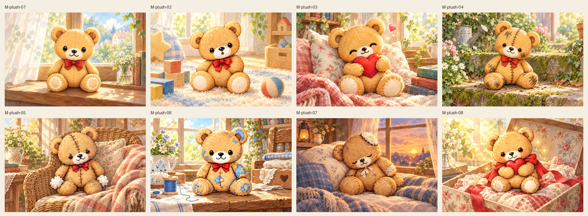
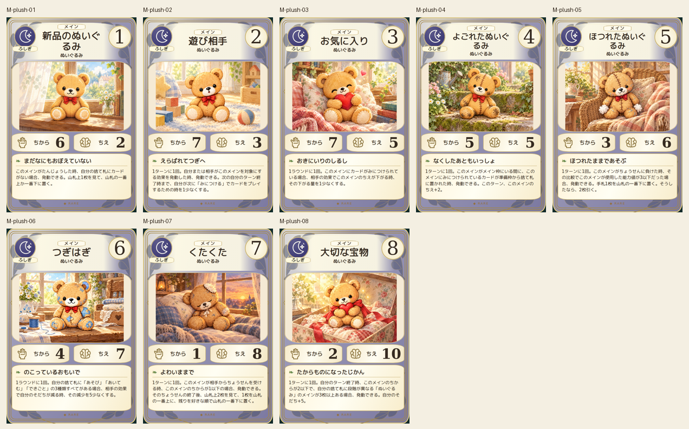
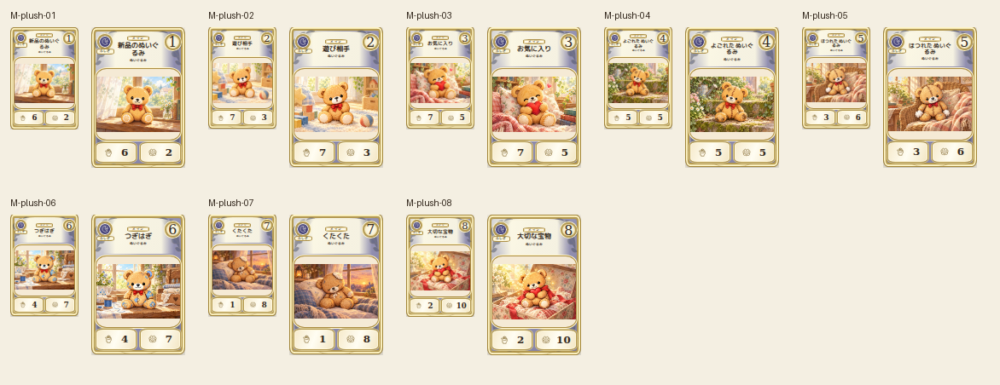

# main-plush-20261019

Eight canonical teddy stages visually compared: new, playmate, heart favorite, dirty stitched, fraying stuffing, blue patches, tired faded and cherished treasure. Stage-specific seam scale, patch placements, face and ribbon preserved; stage07 right rear round protrusion matches canonical tail. Different domestic settings and postures maintain tender story.

完成ID: M-plush-01, M-plush-02, M-plush-03, M-plush-04, M-plush-05, M-plush-06, M-plush-07, M-plush-08

Chromium幅320/390/430、本文・数値、4サイズPNG検証済み。iPhone実機Safari未確認。既存46枚の184ファイル変更なし。ゲーム本体への組み込み・mainマージ未実施。
