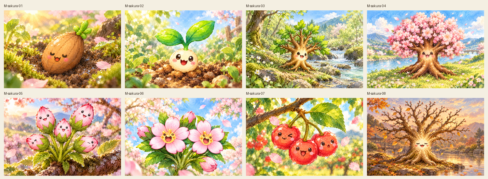
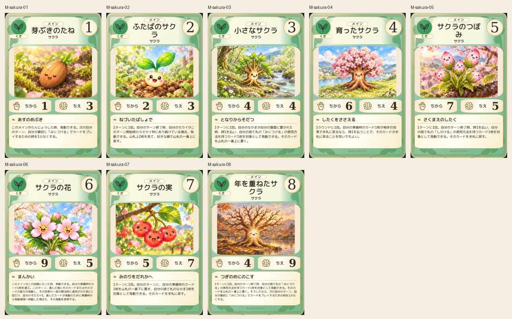
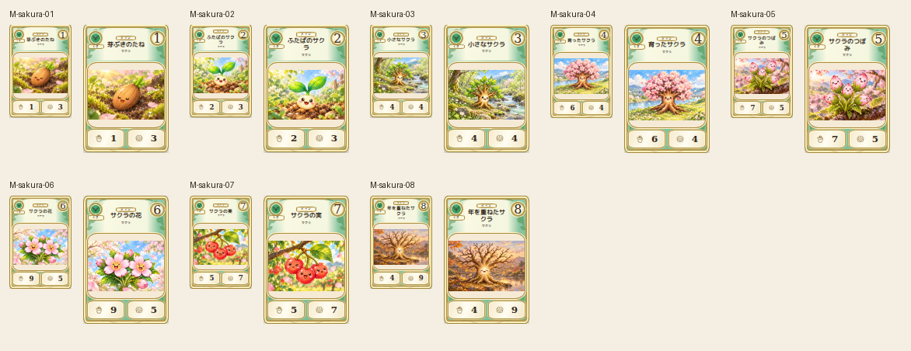

# main-sakura-20261019

Canonical seed, two-leaf sprout, leafy sapling, full blossom tree, five buds, two open flowers, three cherries and bare aged tree compared. Stage06 petals corrected to exactly five per blossom; original retained. Scale changes follow source forms rather than forcing tree shape. Faces and stage colors verified.

完成ID: M-sakura-01, M-sakura-02, M-sakura-03, M-sakura-04, M-sakura-05, M-sakura-06, M-sakura-07, M-sakura-08

Chromium幅320/390/430、本文・数値、4サイズPNG検証済み。iPhone実機Safari未確認。既存46枚の184ファイル変更なし。ゲーム本体への組み込み・mainマージ未実施。
