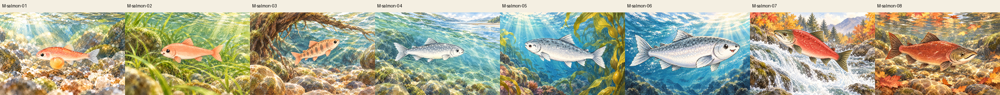
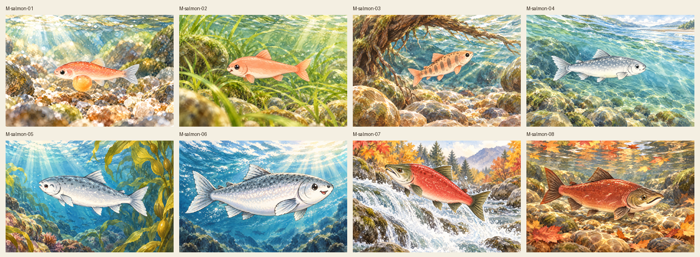
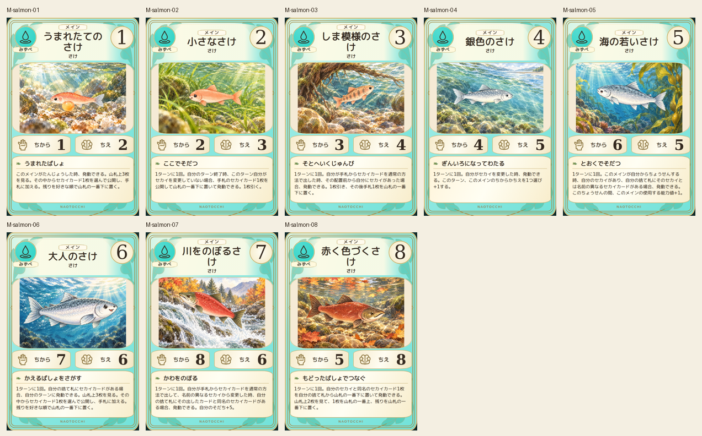
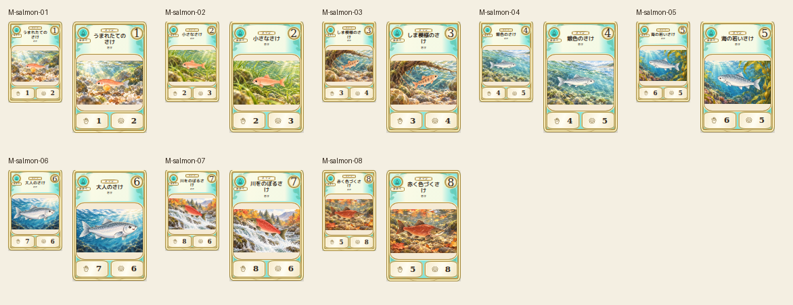

# main-salmon-20261019

Eight source stages compared: yolk sac, pink fry, striped parr, silver smolt, ocean young/adult, red upstream and aged fish. Stages01/03 simplified faces and03/06 direction corrected; originals retained. Different habitat, scale, swimming angle and migration scene. Stage07/08 retain canonical hooked mouths and olive heads.

完成ID: M-salmon-01, M-salmon-02, M-salmon-03, M-salmon-04, M-salmon-05, M-salmon-06, M-salmon-07, M-salmon-08

Chromium幅320/390/430、本文・数値、4サイズPNG検証済み。iPhone実機Safari未確認。既存46枚の184ファイル変更なし。ゲーム本体への組み込み・mainマージ未実施。
