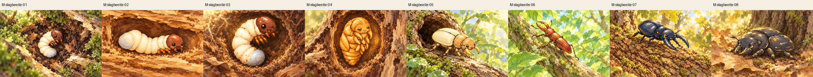
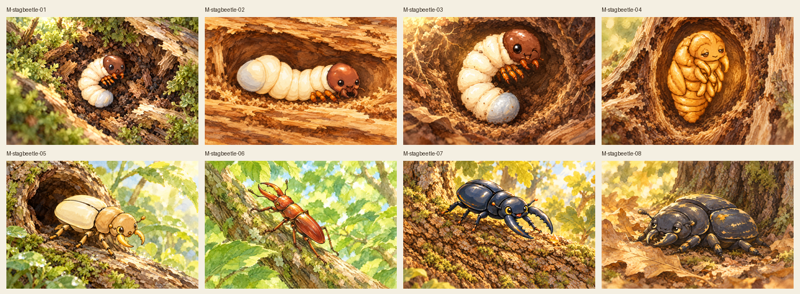
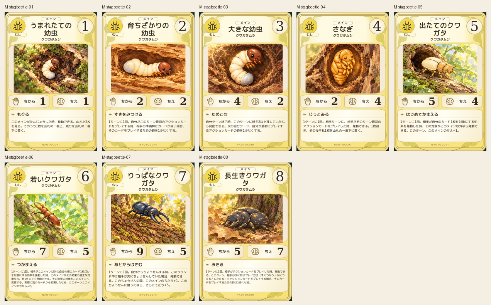
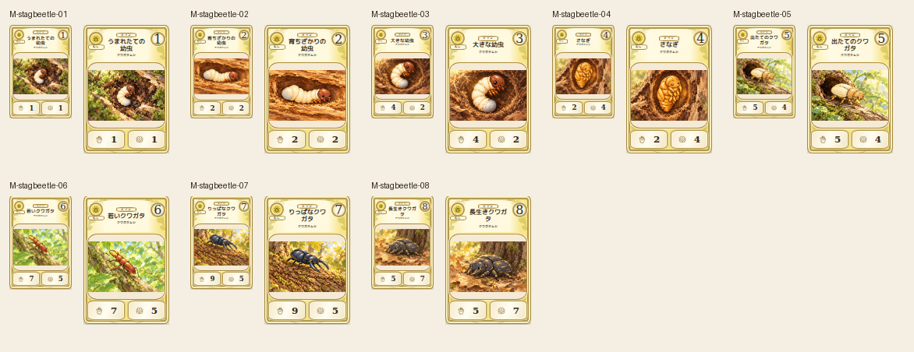

# main-stagbeetle-20261019

Larval C-curve, stretched second larva, thick last larva, golden pupa, pale new adult, reddish young adult, black long-mandibled adult and worn old adult match source. Removed extraneous growth montage from07; original retained. Six-leg attachment and two mandibles checked; habitats, directions and distances vary.

完成ID: M-stagbeetle-01, M-stagbeetle-02, M-stagbeetle-03, M-stagbeetle-04, M-stagbeetle-05, M-stagbeetle-06, M-stagbeetle-07, M-stagbeetle-08

Chromium幅320/390/430、本文・数値、4サイズPNG検証済み。iPhone実機Safari未確認。既存46枚の184ファイル変更なし。ゲーム本体への組み込み・mainマージ未実施。
