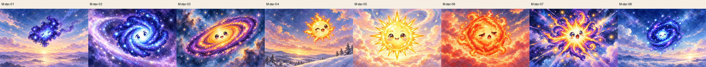
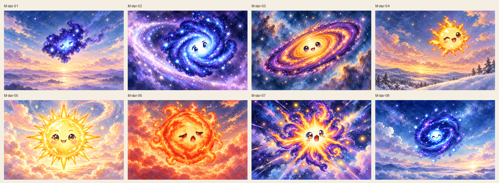
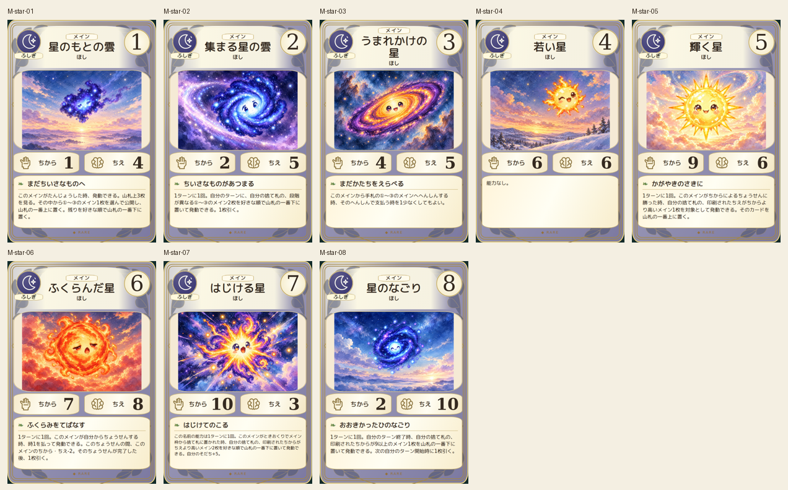
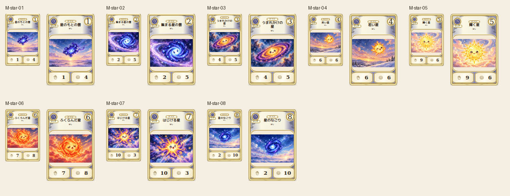

# main-star-20261019

Canonical irregular blue cloud, spiral, orange protostar disk, young sun, sharp-rayed mature star, swollen red star, multicolor burst and blue remnant verified. Faces, rays and growth forms retained; wide dawn, tilted disk, close sun and dynamic burst provide distinct compositions.

完成ID: M-star-01, M-star-02, M-star-03, M-star-04, M-star-05, M-star-06, M-star-07, M-star-08

Chromium幅320/390/430、本文・数値、4サイズPNG検証済み。iPhone実機Safari未確認。既存46枚の184ファイル変更なし。ゲーム本体への組み込み・mainマージ未実施。
