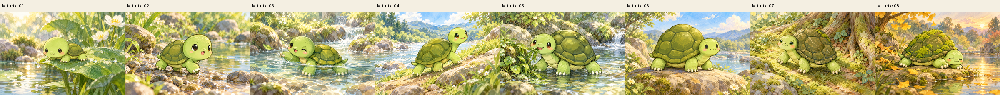
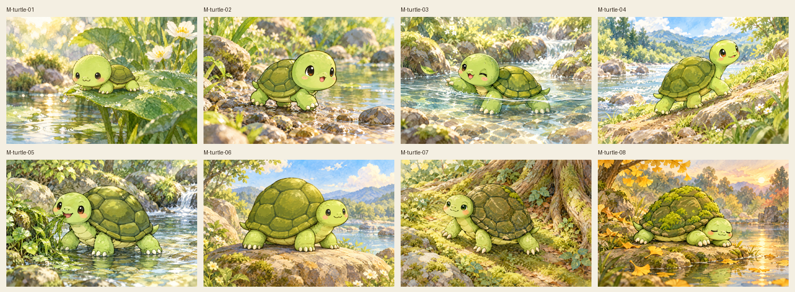
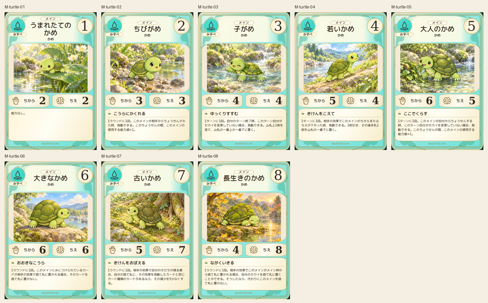
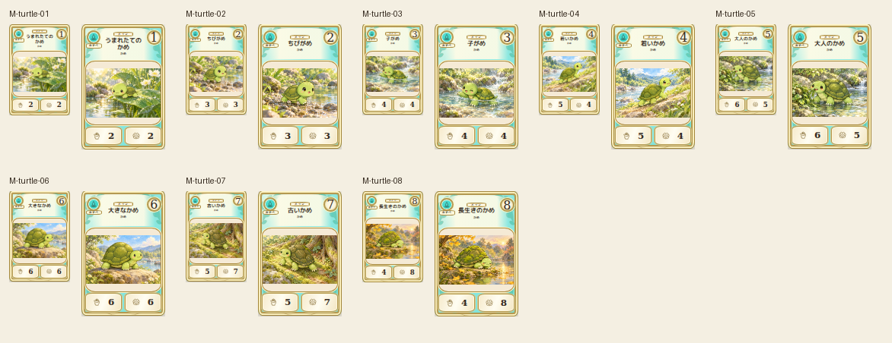

# main-turtle-20261019

All eight shell sizes, face ages, olive polygons, short legs and green skin matched to2D. Left/right alternating actions, low and overhead views, water play, feeding, basking, roots and elder rest compared. Stage08 exact imagegen PNG recovered without regeneration. Four-leg anatomy and tiny-size silhouettes verified.

完成ID: M-turtle-01, M-turtle-02, M-turtle-03, M-turtle-04, M-turtle-05, M-turtle-06, M-turtle-07, M-turtle-08

Chromium幅320/390/430、本文・数値、4サイズPNG検証済み。iPhone実機Safari未確認。既存46枚の184ファイル変更なし。ゲーム本体への組み込み・mainマージ未実施。
