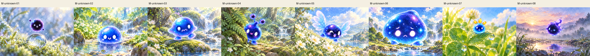
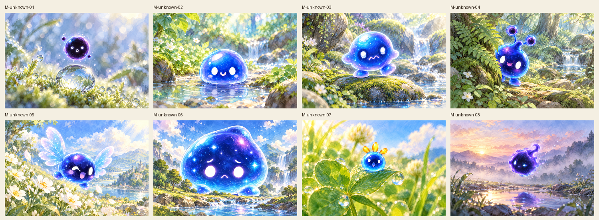
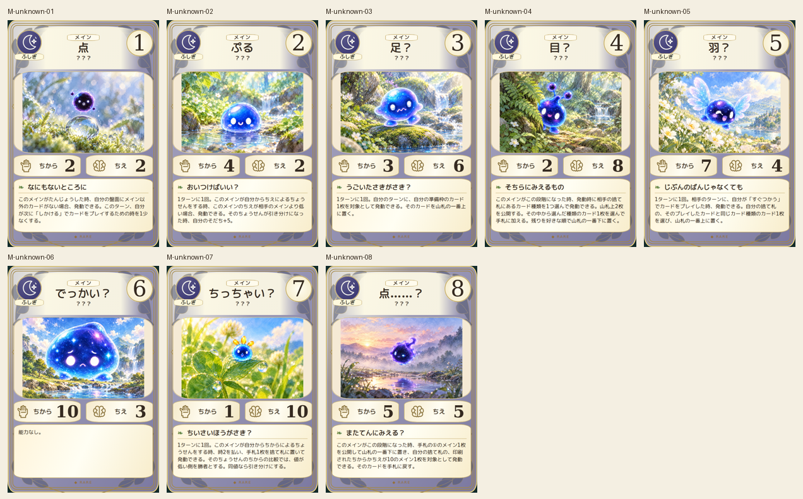
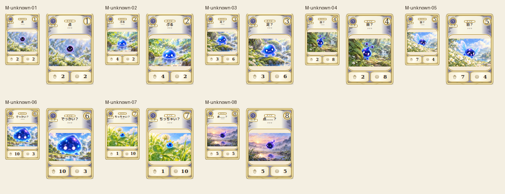

# main-unknown-20261019

All8 canonical forms checked: dark speck, blue mound, two feet, two antenna stalks, wings, huge mound, tiny blob and wispy final speck. Body colors, white eyes and appendage counts retained. Environmental scale cues distinguish huge06 from tiny07, while steps, peek, flight and drift vary poses.

完成ID: M-unknown-01, M-unknown-02, M-unknown-03, M-unknown-04, M-unknown-05, M-unknown-06, M-unknown-07, M-unknown-08

Chromium幅320/390/430、本文・数値、4サイズPNG検証済み。iPhone実機Safari未確認。既存46枚の184ファイル変更なし。ゲーム本体への組み込み・mainマージ未実施。
