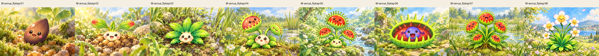
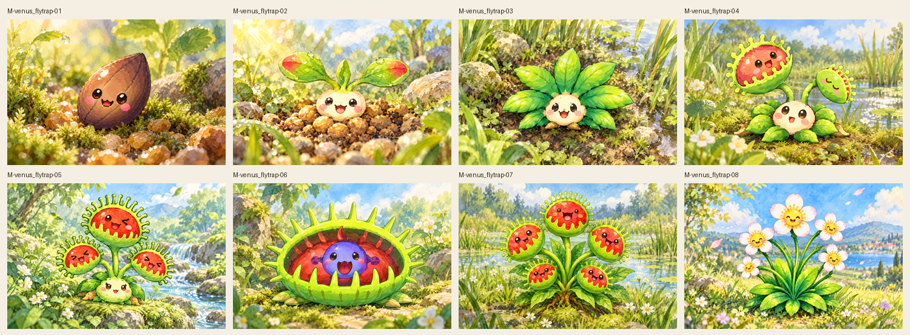
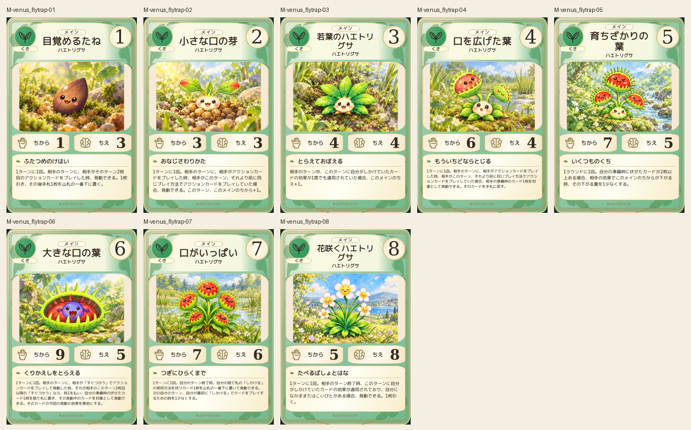
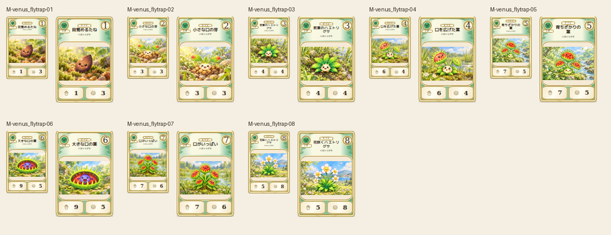

# main-venus_flytrap-20261019

Seed, red-tipped sprout, leafy rosette, two traps, three traps, single large trap with blue inner face, five traps and flowering form matched to2D. Stage08 corrected to five petals per flower and leaf-only base; original retained. Trap counts, facial consistency, plant anatomy, close/overhead views and water settings checked.

完成ID: M-venus_flytrap-01, M-venus_flytrap-02, M-venus_flytrap-03, M-venus_flytrap-04, M-venus_flytrap-05, M-venus_flytrap-06, M-venus_flytrap-07, M-venus_flytrap-08

Chromium幅320/390/430、本文・数値、4サイズPNG検証済み。iPhone実機Safari未確認。既存46枚の184ファイル変更なし。ゲーム本体への組み込み・mainマージ未実施。
