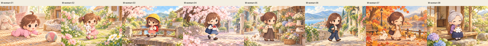
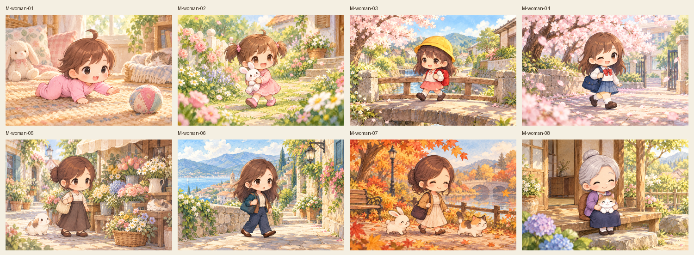
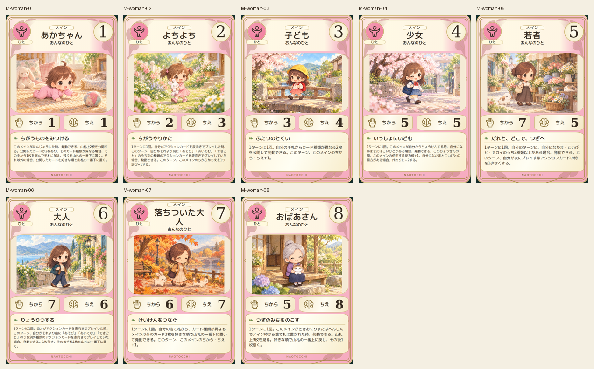
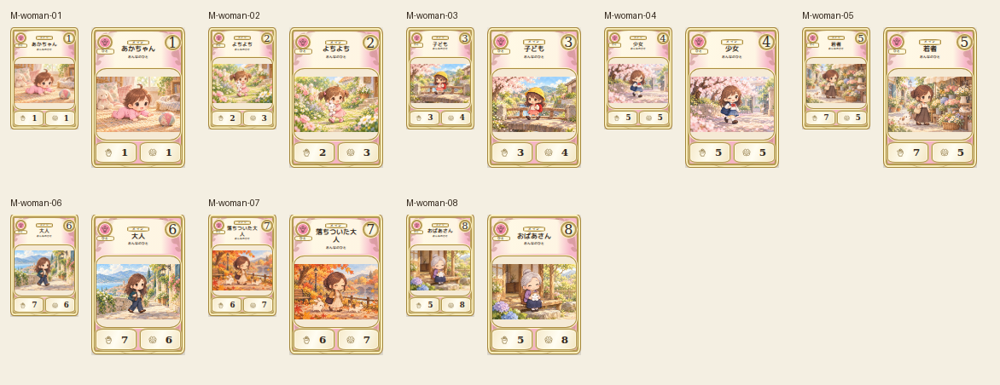

# main-woman-20261019

Eight age-specific hair, clothes, bags, faces and compact chibi body proportions verified. Crawl, toddler toy hug, school bridge, school courtyard, flower market, town walk, autumn stroll and grandmother with cat give life-story progression. Hands, legs and supporting animals inspected; artwork has no text.

完成ID: M-woman-01, M-woman-02, M-woman-03, M-woman-04, M-woman-05, M-woman-06, M-woman-07, M-woman-08

Chromium幅320/390/430、本文・数値、4サイズPNG検証済み。iPhone実機Safari未確認。既存46枚の184ファイル変更なし。ゲーム本体への組み込み・mainマージ未実施。
