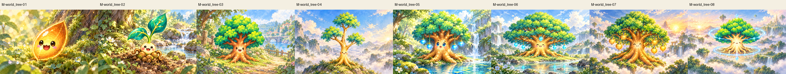
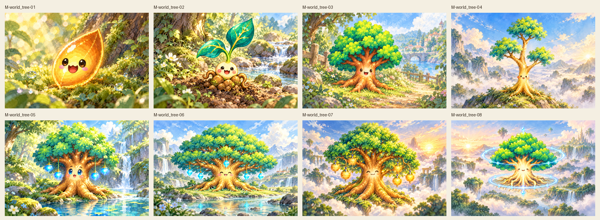
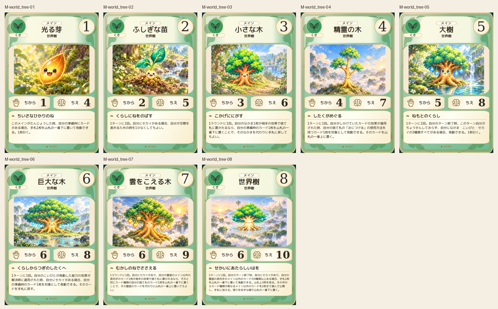
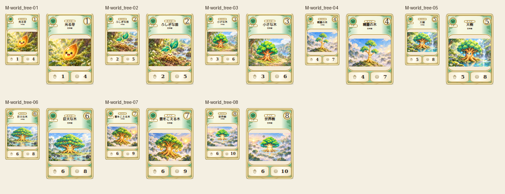

# main-world_tree-20261019

Golden seed, two-veined leaves, short dense tree, slender three-bough tree, blue-orb tree, cyan-diamond giant, golden-fruit cloud tree and cyan-ring world tree compared to2D. Removed premature hanging ornaments from03/04; originals retained. Root shape, faces and canopy forms checked; macro, path, ridge, water and cloud scale progression verified.

完成ID: M-world_tree-01, M-world_tree-02, M-world_tree-03, M-world_tree-04, M-world_tree-05, M-world_tree-06, M-world_tree-07, M-world_tree-08

Chromium幅320/390/430、本文・数値、4サイズPNG検証済み。iPhone実機Safari未確認。既存46枚の184ファイル変更なし。ゲーム本体への組み込み・mainマージ未実施。
