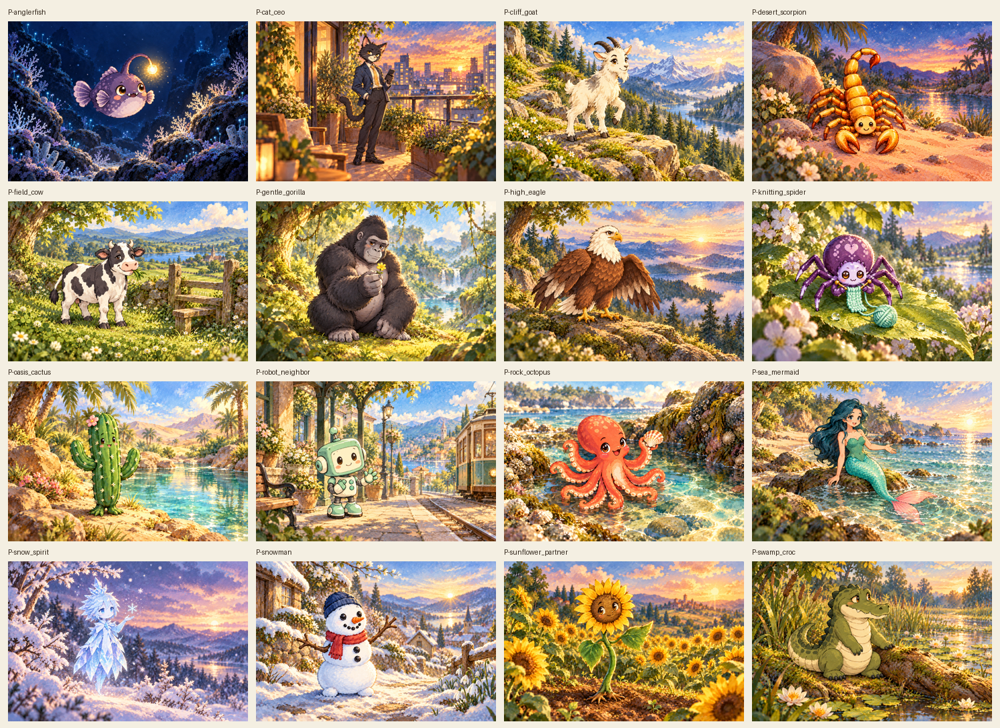
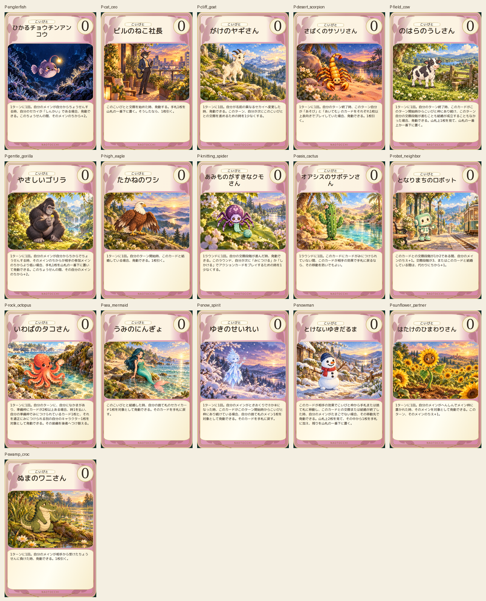
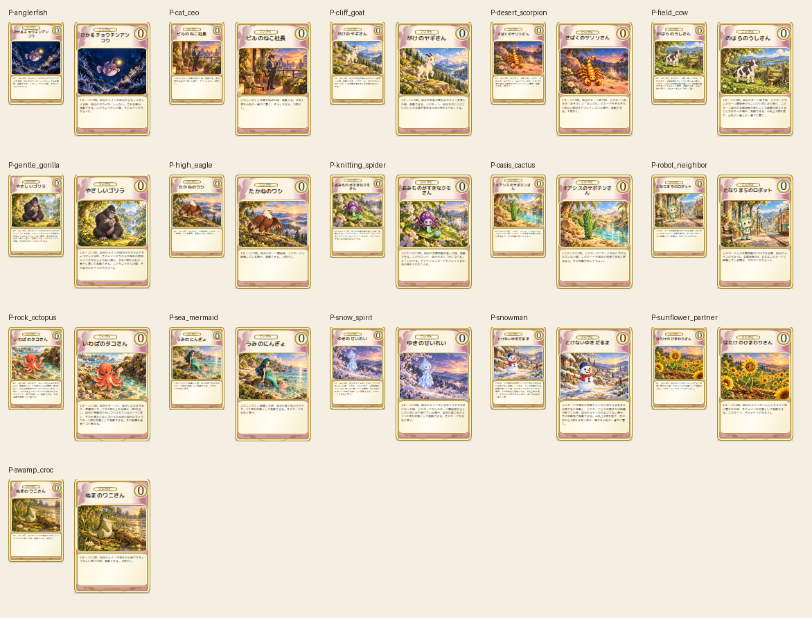

# こいびと追加16枚 — 2026-10-18

累計85/452枚、残り367枚。このロットは全16枚の画像・カード・縮小表示を確認済み。

アンコウ初稿の浅海表現を深海へ修正。初稿は保存。生成プロンプトと場面はpartners-prompts.json、出典ref/blob・画像SHA256は共通provenance.jsonに記録。

専用絵1536×1024 PNG、カード600×900 PNG、縮小80×120と110×165 PNG。Chromium153で本文・名前・コスト・全文収容・画像非重複・採用色#C04479・既存分類表示・植物装飾を照合。320/390/430px横はみ出しなし。画像破損・欠落・ID重複なし。元46枚のアートと3サイズプレビュー184ファイルをGit blobで保護確認。

次の未制作IDは共通rollout/progress.jsonを参照。全452枚完成ではない。ロット承認待ちは不要。ゲーム本体・ルール・本文・数値・main・PRのbaseは変更しない。PR #393はDraft/open/未マージを維持。旧46枚の配色採用前プレビューは保護し、最終版は別出力とする。iPhone実機Safariは別工程。
