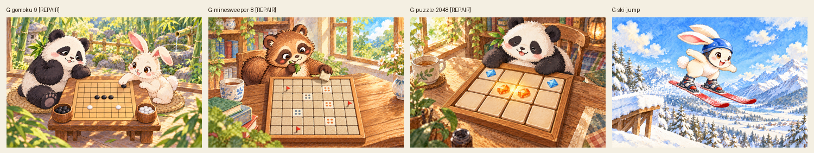
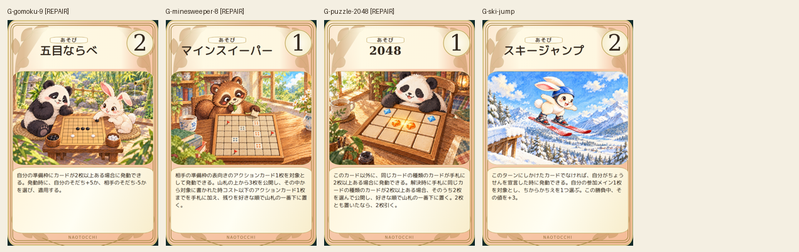
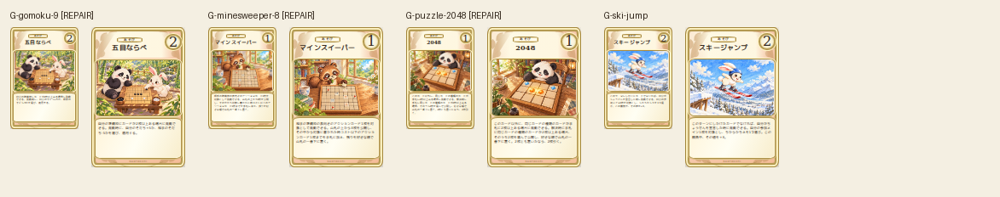

# repairs-20261019

Ski-jump revised and visually accepted: two distinct boots attached to two skis. Three board-game candidates still have incorrect grid geometry: gomoku eight horizontal vs nine vertical lines, minesweeper seven rows vs eight columns,2048 three rows vs four columns. All originals and new failed candidates preserved; these three not counted complete.

完成ID: G-ski-jump

修正待ち: G-gomoku-9, G-minesweeper-8, G-puzzle-2048

Chromium: 600×900 /80×120 /110×165、幅320/390/430検証済み。iPhone実機Safariは未確認。本文・数値・本編資産変更なし。
