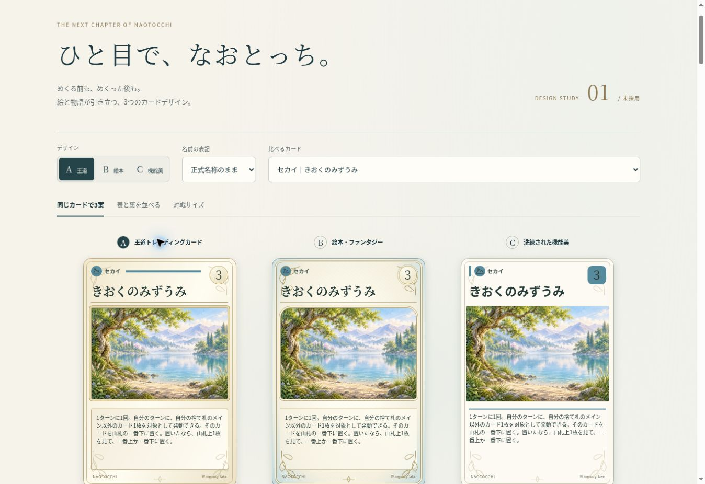

# なおとっち CARD GAME — デザイン比較 VERSION 1

**正式採用前の独立した比較試作です。** 既存452枚＋追加候補7枚を閲覧できます。ゲームの処理・本番CSS・保存データを変更せず、このディレクトリだけを追加しています。

## 開く

本人限定比較ページ： https://naotocchi-card-design-v1-20261114.kerzion214.chatgpt.site

「同じカードで3案」「表と裏を並べる」「対戦サイズ」を切り替え、カードをタップすると表裏反転できます。拡大すると効果全文を読み比べられます。3列一覧は36枚ずつ切り替え、全459枚を検索できます。代表40枚には高解像度版、それ以外には正式small版を使用します。画像の再生成・再圧縮はしていません。



## 1. 固定した仕様と出典

| 対象 | 検証した保存状態 |
|---|---|
| main | `105dba519890c2dc17e94a8c9d1b7679720fddf3` |
| PR #393 | `a6ad1a9689335f0379d5c6795d1da8652f02ac0d` |
| PR #498 | `948026343099e34628f5655ae240d1083763ea9e` |

PR #393とmainの `approved-colors.mjs`、`attributes.mjs`、正式裏面はバイト単位で一致。`ui-presentation.mjs` の正式SVGを直接使用し、レア◆の意味（同名1枚まで）も維持。メインは既存表示に合わせ段階を通常時コストとして表示します。効果文・結婚効果・ID・正式名称はコピー元から変更していません。たまごは既存の状態表示画像を別枠で提示し、459枚のデッキ用一覧には混ぜません。

| 属性 | 正式色 | 分類 | 正式色 |
|---|---|---|---|
| ひと | #F17D9D | なかま | #C68A32 |
| けもの | #95603C | こいびと | #C04479 |
| みずべ | #27D3C5 | セカイ | #568A9D |
| うみ | #2878E8 | あそび | #EF9860 |
| むし | #F2D12E | あいてむ | #B7A48C |
| くさ | #269451 | できごと | #9298A5 |
| げんそう | #B58BE3 | メイン | 対応する属性色 |
| ふしぎ | #35316E | | |

PR #498の7枚は原画PNG・配信用WebPが完成していることを実ファイルで確認。原画7枚はRGB・1536×1024、すべて既存manifestのSHA-256に一致。新たに生成していません。配信用499画像（459 small＋代表40 large）の検証記録は `asset-verification.json`、原画は `originals-verification.json` に保存。

## 2. 正式裏面の分析

`ui-assets/card-back-approved.png` は1086×1448、3:4。SHA-256：`028114e02034a5c5d84a0ace2c97babb92363e19eed6249f87cc591897189872`。

実画像には、中心に向かって明るくなる青〜青緑の織物のような質感、淡いシャンパンゴールドの二重枠、左右対称の植物の輪、中央の双葉、星形と点の細い装飾があります。角は丸く、紋章の周囲には余白があり、密な模様で埋めていません。

表面では淡い金、細い二重線、小さな葉、柔らかな角を共通化。裏面の紋章は複製して表に敷かず、絵と情報のための余白を確保しました。正式裏面はそのまま表示し、変更候補は作っていません。表面は既存UIの2:3比率、裏面の原画は3:4なので、裏面をcontainで全景表示し上下を青で補います。原画を引き伸ばしたり切り取ったりしません。

## 3. 現状の問題と3案

現行の名前は `card-title-lines.mjs` でcompactとfullの異なる幅（54×.97 / 72×.97）に合わせて組版し、CSSでもcompactの左右予約幅とfullの予約幅が異なります。メイン専用改行指定や `<wbr>` もあるため、一覧2行・拡大1行が発生します。これは文字列自体の不一致ではなく、別々の組版条件によるものです。

| 案 | 情報設計 | 裏面との相性（デザイン上の評価） |
|---|---|---|
| A 王道 | 名前・分類・コスト・絵・効果を明確に分離。金の額縁と紙の温かさ | 高い。上品な金枠を共通語にする、最も安定した構成 |
| B 絵本 | 淡い青の外周、植物の細線、柔らかなアーチ状の絵枠 | 3案で最も強い。裏面とつながる色調・細い植物装飾 |
| C 機能美 | 細い枠、大きな絵、簡潔な分類帯、角形のコスト | 穏やか。最も整理されているが、裏面の装飾性との距離は大きい |

全案とも分類の正式色とマークは同じです。できごとは分類を左上、レアとIDを下部に集約し、中央の3:2イラストを主役にしました。効果の短いカードでも絵や効果欄の開始位置が揃います。メインは能力値を専用帯、こいびとは交際時と結婚後の見出しで区別します。長文は内容を削らず、カード内のスクロールと拡大時の独立した全文欄で読めます。

## 4. 1行化と漢字・ふりがな

一覧・比較・拡大・対戦サイズは同じ `front()` と `titleInfo()` で描画し、名前幅78%、左寄せ、改行なしに統一。右上コストとは領域を分離しました。表示する459枚は1行に収まります。ただし、**1行に収まることと、3列の小さなカード内で読みやすいことは別です。** 一覧には11pxのカード外ラベルも併記し、タップで拡大できます。

特に注意する2枚（閾値6.2cqw未満）：

| 正式名称 | 表示候補 | 原名のサイズ |
|---|---|---|
| あやまりにきただいおういか | 謝りにきた大王イカ | 約5.80cqw |
| どこにもつながらないかいだん | どこにもつながらない階段 | 約5.38cqw |

最長名は390px幅の3列一覧で約6.1px、320px幅では約4.9pxです。カード内だけで快適に読むには不十分です。これを解消するには、漢字候補の採否、一覧カード幅、または長名の例外ルールの選択が必要です。正式名称を無断で短縮していません。

「記憶の湖」「大きな病気」「運命の変身」等は比較表示テーブルにだけ登録。原名／漢字／漢字＋ふりがなを切り替えられます。ふりがなは専用の上側余白に置き、カードの高さを変えません。ただし3列では極小になるため、採用検討時には**一覧は漢字＋カード外ラベル、拡大では必要な語だけふりがな**を推奨します。今回の3モードは選択のための比較であり、名称変更や正式採用ではありません。

## 5. 研究した情報設計

模様や枠を模写せず、次の公式資料から「名前・使用条件・絵・効果・補助情報の階層」を参考にしました。

- [ポケモンカード公式・遊びかた](https://www.pokemon-card.com/howtoplay/)：名前と主要数値を上部、使用する効果を下部に分離。
- [Magic公式・カードの構造](https://magic.wizards.com/en/news/feature/anatomy-magic-card-2006-10-21)：名前／コスト、タイプ、ルール、付随情報の階層。
- [遊戯王公式ルールブック](https://img.yugioh-card.com/en/downloads/rulebook/SD_RuleBook_EN_10.pdf)：名前・属性等の識別情報と本文の役割分担。
- [ディズニー・ロルカナ公式カードギャラリー](https://cards.disneylorcana.com/en-US/)：カード名・インク・コスト等の識別軸を確認。

## 6. 検証結果と限界

- 既存CARD GAMEテスト：658/658成功。
- 比較版の名前・名称不変・エスケープに関するテスト：3/3成功。JavaScript構文確認成功。
- 320 / 375 / 390 / 430 CSS pxのブラウザ内フレームでA/B/Cの12通りを検証。代表カードの名前は欠けず、ページ横はみ出しなし。
- 390px・C案では全459枚を13ページに分けて確認し、名前欄の横はみ出し0。全案は同一の名前組版を共有。
- 一覧ページ送り、追加7枚の読み込み、モーダル拡大、モーダル内A/B/C切替、表裏反転、漢字／ふりがな、対戦サイズ、表裏並列を実操作確認。
- 対戦サイズ3枚は390pxで約107×161px。表示崩れを修正して再確認済み。
- 独立レビューで指摘された追加データの出典SHA、固定元ファイル検証、対戦表示の高さ、メインのコスト表記を修正。
- リポジトリ全体の `npm test` も開始したが、無関係な3Dワールド系の長時間テストが継続したため中断。全体の成功は主張しません。今回の対象の658件は完走しています。
- **物理iPhone Safari / WebKitでの実機検証は未実施。** 上記はChromeでの幅別検証です。本人限定URLをiPhoneで開いて確認できる段階まで完成しています。

## 7. 再現と保護範囲

リポジトリルートから実行（先に上記mainとPR #498のコミットを取得）：

```sh
node prototypes/card-game/design-comparison-v1-20261114/build.mjs /absolute/path/to/output
node --test prototypes/card-game/design-comparison-v1-20261114/title.test.mjs
node --test prototypes/card-game/tests/*.test.mjs
```

`build.mjs` は既存公式ファイルが固定mainと一致することを検証してから別出力先へ書き出します。元画像への上書きなし。比較版のCSSは既存 `style.css` から独立。本番画面への接続、mainへのマージ、本番GitHub Pages公開、PR #498への書き込み、ゲーム進行や保存への接続は行いません。

採用はA/B/Cの選択待ちです。このPRをそのまま本番へ一括適用する意図はありません。
