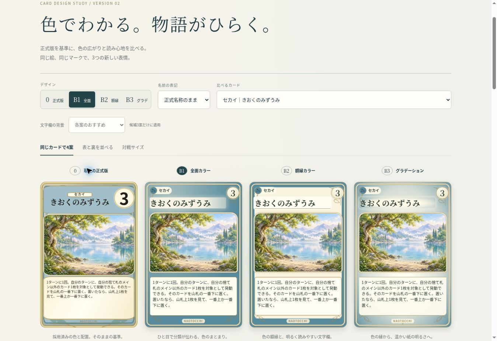
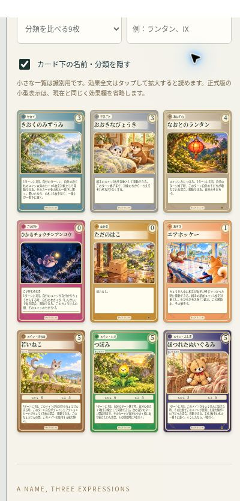

# カードデザイン VERSION 2 — 正式版・B1・B2・B3

**採用前の本人限定比較。正式カードやゲーム本体への適用はありません。** VERSION 1の13ファイルと公開済み506ファイルを変更せず、PR #551へ独立したV2ディレクトリだけを追加しました。

- [VERSION 2 比較ページ](https://naotocchi-card-design-v1-20261114.kerzion214.chatgpt.site/v2/)
- [VERSION 1（保存済みのまま）](https://naotocchi-card-design-v1-20261114.kerzion214.chatgpt.site/)
- [Draft PR #551](https://github.com/Naoto214/naotocchi/pull/551)



## 比較結果

以下は画面確認に基づくデザイン上の評価です。ユーザーによる採用決定ではありません。

| 案 | 分類の識別 | 名前・効果の読みやすさ | 正式裏面との統一感 |
|---|---|---|---|
| 0 正式版 | 全面色・名前帯・外周で明快 | 現行の改行・大きなコストをそのまま保持。小型は本文省略 | 採用済みの植物と金枠 |
| B1 全面カラー | **最も強い**。9枚で色面がはっきり分かれる | 名前の背後を明るくし、効果を独立クリーム欄へ | 全面色に金の二重枠。裏面とカードらしい一体感 |
| B2 額縁カラー | 色付きの太めの外周で判別 | **最も安定**。中央と文字欄が明るく均一 | 淡い金と紙の質感が上品。裏面より軽い印象 |
| B3 グラデーション | B1より穏やか。外側の色で判別 | 中央を明るくし、名前を自然につなぐ | **最も柔らかくつながる**。裏面の中心が明るい質感と調和 |

ユーザーの優先順位「分類・属性を一目で判別」を最優先するなら、**B1を第一候補**としておすすめします。文字欄を明るく独立させることで、色面と読字領域を両立しました。文字の落ち着きを最優先するならB2、柔らかさのバランスならB3です。未採用のまま実際に比較してください。

## 操作と9枚比較

上部の0／B1／B2／B3で3列一覧と表裏比較を切り替えます。同じカードの4案を並列表示でき、スマートフォンでは横にスワイプして比較できます。カード面をタップすると反転、拡大ボタンや一覧タップで本文全文を表示します。

「分類を比べる9枚」は7分類＋異なるメイン属性の固定セットです。デザインを切り替えても同じカードが残ります。「カード下の名前・分類を隠す」で、色とカード内マークだけを頼りに見比べられます。全8属性、各分類、追加7枚、長名、長文、短文、全459枚で絞り込めます。



## 文字の設計

候補3案は英語IDをカード面から削除し、署名を最下部中央のNAOTOCCHIだけに統一。IDは拡大後の補助情報欄に残します。レア◆とその意味は従来どおりです。名前は左寄せ1行、コストは独立した右上領域とし、両者の矩形が重ならないことを測定しました。

文字欄は「各案のおすすめ」に加え、独立クリーム／自然な明るさ／金の境界線の3方式を切り替え可能です。この変更は候補だけに適用し、0案には影響しません。

原名／漢字候補／ふりがな比較は残しています。正式名称は不変。下部の表記サンプルを拡大しても、その表記を維持するよう修正しました。0案は常に正式名称のままです。

本文はV1の通常3.45cqwから4.0cqwへ、長文も3.15cqwから3.7cqwへ拡大。メインでは能力値との兼ね合いで3.7cqw／長文3.5cqwです。ただし3列の100px前後のカードでは、本文を快適に読むには物理的に小さいままです。全文を省略・改変せずカード内スクロールと拡大時14pxの独立本文欄を併用します。一覧の小さなスクロールバーは非表示です。

最長の「どこにもつながらないかいだん」と「あやまりにきただいおういか」は1行に収まりますが、一覧カード内だけでの可読性には限界があります。漢字候補・カード外ラベル・拡大を比較する対象です。ルビも小型一覧より拡大表示向けです。全カードの文字が小型で十分読めると主張していません。

## 正式版の忠実性と保存元

| 対象 | 固定した保存状態 |
|---|---|
| main／正式表示 | `105dba519890c2dc17e94a8c9d1b7679720fddf3` |
| PR #551 VERSION 1 | `6aecc6b1e4eaa72834d6c6111457a1f075889544` |
| PR #498 追加7枚 | `948026343099e34628f5655ae240d1083763ea9e` |

現行正式版はstyle.cssの採用済みAB-softです。0案は `ui-presentation.mjs` の `cardMarkup()` 出力と、**改変していないstyle.css全体**を使用。Shadow DOMへ隔離し、候補のCSSが正式面を上書きしないようにしています。既存452枚について元の関数の出力と全文一致を検証（画像URLの配置先変更だけを除外）。一覧は正式compact、拡大と4案比較は正式fullを使用するため、正式版の既存改行や効果欄省略も維持されます。

追加7枚はまだ本番の452枚に含まれません。0案では元の表示関数に候補データを渡し、画像だけ完成済み候補に結び付けた**正式レイアウトの参考表示**です。本番採用済みとは表示しません。7枚のID・出典SHA・効果・コストを維持しています。

候補にも正式の8属性色・6分類色、公式SVG、レア、本文・結婚効果・能力値を使用。新たな分類色体系はありません。カラーを明るくする際は同じ正式色とクリーム／白を混ぜています。制作済み画像は再生成・再圧縮せず、small459＋代表large41＝500画像を検証して再利用しました。代表以外の拡大はsmall素材を使用します。

正式裏面は1086×1448、SHA-256 `028114e02034a5c5d84a0ace2c97babb92363e19eed6249f87cc591897189872` の同じPNG。細い植物・金の二重枠・丸みを候補に引き継ぎ、裏面そのものは変更していません。3:4の原画を2:3のカード領域で全景表示するため、上下の青い余白を維持しています。

## 検証

- `verify.mjs`：452枚のデータ・正式マークアップ一致、459枚の色／マーク／結婚効果、追加7枚の出典SHA、9枚全7分類、500画像SHA、正式CSS・裏面一致、V1の13ファイル一致を確認。
- 公開済みV1の506ファイルは、編集前後のSHA-256がすべて一致。
- 名前関連テスト3/3成功。app/build/official-cardの構文確認成功。
- Chromeの320／375／390／430 CSS pxフレームで4案の16通りを確認：ページ横はみ出し0。候補カードの名前横はみ出し0、名前欄とコストの重なり0。
- 320px・B1で全459枚を13ページに分けて確認：名前欄の横はみ出し0。他の候補は同じ組版関数と文字サイズを共有。
- 文字欄3方式×候補3案、長名ルビ、属性フィルタ、追加7画像読み込み、追加カードの0案、長文結婚効果の全文、短文、反転・拡大・表記保持を実操作確認。
- 独立レビューで発見された「表記サンプルから拡大すると原名に戻る」問題を修正し、ルビ表示が拡大・案切替後も維持されることを確認。
- **物理iPhone Safari・WebKitによる表示試験は未実施。** 利用可能な管理ブラウザはChromeでした。幅別検証はSafari実機検証とは区別しています。
- ゲーム処理や既存ファイルは無変更のため、今回の対象検証に限定。V1で完走済みの既存CARD GAME658件を今回再実行したとは扱いません。

`browser-verification.json` と `verification.json` に確認結果を保存しています。

## 再現

上記main・PR #498・PR #551のコミットが取得済みのリポジトリで実行します。

```sh
node prototypes/card-game/design-comparison-v2-20261114/build.mjs /absolute/output/v2
node prototypes/card-game/design-comparison-v2-20261114/verify.mjs /absolute/output/v2
node --test prototypes/card-game/design-comparison-v2-20261114/title.test.mjs
```

追加ディレクトリのみが変更範囲。mainマージ、本番GitHub Pages変更、PR #498変更、V1変更、時計・CPU・保存形式・正式画像・裏面・効果の変更はありません。今回も比較までで、全カードへの正式反映は選択後の別工程です。
