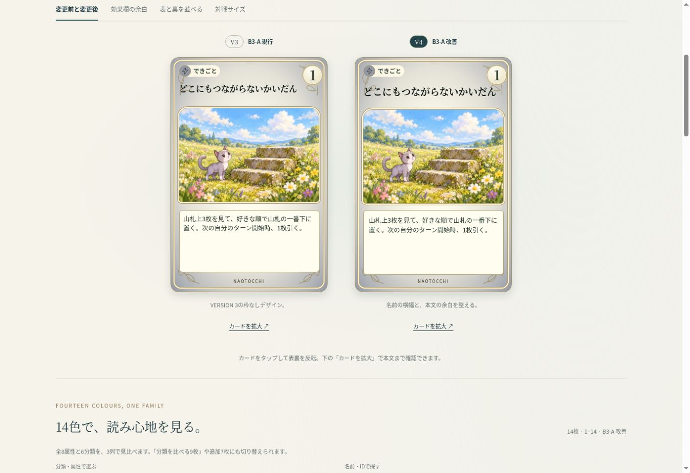
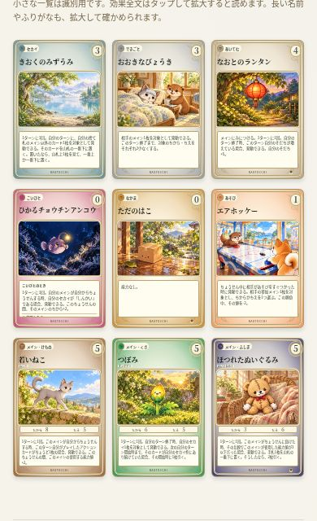

# なおとっち CARD GAME — VERSION 4

B3-Aを完成候補として磨く独立比較ページ。正式採用・本番反映は行わない。PR #551でV1〜V3と併存する。

本人限定URL: https://naotocchi-card-design-v1-20261114.kerzion214.chatgpt.site/v4/

## 比較方法

「B3-A 現行」と「B3-A 改善」を同じカードで比較できる。変更前後、効果欄の余白、正式裏面との並列、対戦サイズを切り替える。全14色・分類を比べる9枚・全459枚・追加7枚・長い名前・長短の効果を3列一覧で選べる。カードをタップすると反転し、「カードを拡大」で全文を読む。

正式名／漢字／必要なふりがなを並列比較する。既定では小さな一覧と対戦サイズのルビを省き、拡大先に表示する。チェックを外すと小サイズにも表示できる。現行版はV3のルビ仕様を保持する。

## B3-Aからの改善

| 対象 | V3の現行B3-A | V4改善候補 |
| --- | --- | --- |
| 名前の横幅 | 78cqw | 88cqw（ルビ表示時78cqw） |
| 短い名前の最大文字サイズ | 7.8cqw | 7.4cqw |
| 最長名の文字サイズ | 5.383cqw | 6.073cqw、約12.8%拡大 |
| 名前の配置 | 既存位置 | ラベル・コストより下の独立した1行、太さ700・字間0 |
| イラスト | 上端32cqw | 上端33cqw、幅・高さ・画像は維持 |
| 非メインの効果欄 | 内余白2.4cqw、行間1.46 | 内余白3.2cqw、行間1.52、下端を1.5cqw拡張 |
| 長い効果 | 文字3.7cqw | 3.8cqw・行間1.48・内余白2.6cqw |
| 拡大先の全文 | 14px | 16px・行間1.85 |

名前の背景、局所的な白い光、新しい装飾は追加していない。全面グラデーション、正式14色、分類枠、円形コスト、二重金枠、植物模様、下中央の枠なしNAOTOCCHIは維持。効果欄は温かいクリームと細い金線を維持した。短文も長文もテキスト上揃えで、文字量によってカードやイラスト位置を変えない。メインは既存の能力値欄のため効果欄上端が異なる。

## 名前と漢字・ふりがな

459枚を320・375・390・430 CSS pxで全ページ確認し、名前の横はみ出し・コストとの重なりは0。12文字以上の名前は7枚（`catalog-audit.json`）。最長は「どこにもつながらないかいだん」（14文字）。ただし320pxの3列一覧では改善後でも約5.5pxで、はみ出さないことと読みやすいことは同義ではない。カード外の12px名前ラベルと拡大表示を併用する。正式名の短縮はしていない。

漢字候補は14件。記憶の湖、大きな病気、運命の変身、救急箱などを表示だけで比較する。大・思・出・早・好・物・旅・時間などはルビを省き、それ以外の候補部分には読みを付ける（学年別の習得保証ではない）。一覧では漢字のみ、拡大で必要なルビ、という組み合わせが小画面には適している。正式名称・ゲーム検索・データ・IDは不変。比較ページ自身の検索対象もV3の正式名・既存漢字別名を維持し、新しい漢字候補は検索別名へ追加していない。

## 効果文

最長は「いわばのタコさん」の166文字（結婚時効果を含む）。カード内に収まりきらないときは外側に「効果全文は拡大」を出し、拡大画面の16px本文で全文を確認できる。小さな3列一覧の本文を無理に読ませる設計にはしていない。

全459枚のブラウザ出力本文を元データと照合し、通常効果・結婚時効果の一致を確認した（`effect-copy-verification.json`）。余白比較から拡大した場合も、選んだ現行／改善の余白を維持する。

## 全14色・表裏の調和

8属性（ひと・けもの・みずべ・うみ・むし・くさ・げんそう・ふしぎ）と6分類（なかま・こいびと・セカイ・あそび・あいてむ・できごと）は全て正式値と一致。9枚の一覧で7種類のカード分類を同時に見られる。濃い紫や茶色でも、外周の色を残したまま中央の明るいグラデーション上に名前が載る。金枠・植物・クリーム色の本文領域と正式裏面の組み合わせはV3-Aの統一感を保っている。

14色の名前領域を同じCSS背景のスクリーンショットで測定した最低比はV4約5.09、V3約4.86。NAOTOCCHIはV4約5.33。色体系は変更しておらず、名前位置の調整による差。これは背景画素の参考値であり、植物線・文字のアンチエイリアス・実機の見え方を含めたWCAG適合判定ではない。測定画像・領域・スクリプト・結果を同梱した。

正式裏面は元画像のまま。元画像3:4を2:3のカードに`contain`表示する既存処理も維持している。

## 検証結果と限界

- Chrome/CUAのiframeで320・375・390・430 CSS pxを検証。物理iPhone Safari・WebKitは未検証。
- 全459枚 × 4幅、52ページで名前のはみ出し・コスト重なり0。
- 14色 × 2デザイン × 4幅で3列・ページ横幅・名前／分類／コスト／絵との重なりを確認。
- 長名7枚 × 2デザイン × 3表記 × 4幅を確認。ルビを小サイズに表示する条件も確認。
- 表裏並列・対戦サイズ・効果余白比較 × 4幅でページ横はみ出し0。
- 追加7枚の画像読込、時IX〜XII、反転、拡大、救急箱ルビ、正式名検索、長文全文、比較設定の保持を操作確認。
- 名前関数テスト6/6成功。独立コードレビューで重要な指摘なし。
- 452枚の正式データと正式描画用マークアップ、追加7枚、14色／マーク、500画像のSHA-256、正式裏面を検証。
- V1〜V3のリポジトリ52ファイルと公開済み静的ファイル1,525件は変更前と一致。

`browser-verification.json`に画面幅別の測定と操作結果、`verification.json`に保護検証、`site-preservation.json`に旧ページ保全結果を保存した。大量ページの走査は次へボタンのEnter操作で行い、タップ相当のクリックでは反転・拡大等を確認した。実機でのタッチ精度を保証するものではない。





## 再現と保護

リポジトリルートから、独立した出力先を指定する。

```sh
node prototypes/card-game/design-comparison-v4-20261114/build.mjs /tmp/naotocchi-v4
node prototypes/card-game/design-comparison-v4-20261114/verify.mjs /tmp/naotocchi-v4
node --test prototypes/card-game/design-comparison-v4-20261114/title.test.mjs
```

参照main: `105dba519890c2dc17e94a8c9d1b7679720fddf3`。参照PR #498: `948026343099e34628f5655ae240d1083763ea9e`。V3基準: `61dea6960287f6e82c33f8dc3d75a108419d8779`。

新規変更はこの独立ディレクトリのみ。完成済みアートを再利用し、PR #498、正式色・画像・裏面、効果・コスト・ID・ルール・CPU・時計・デッキ・保存・本番CSS・main・GitHub Pagesは変更していない。特別カードは既存の扱いを維持する。
