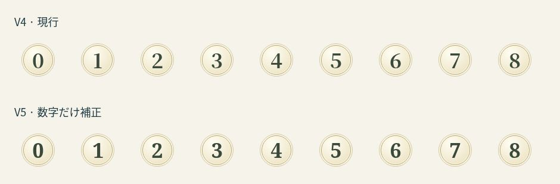
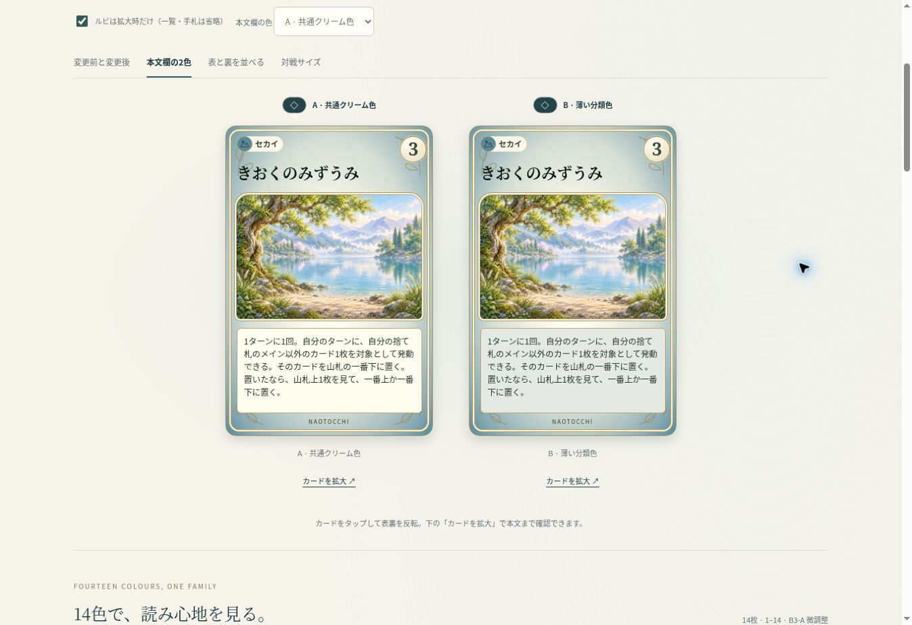

# なおとっち CARD GAME — VERSION 5

B3-Aの最終微調整を本人限定で比較する。正式採用・本番反映はしない。

比較URL: https://naotocchi-card-design-v1-20261114.kerzion214.chatgpt.site/v5/

## 比較の操作

- **デザイン**: V4改善版を基準とする「B3-A 現行」／「B3-A 微調整」。
- **本文欄の色**: A共通クリーム／B薄い分類色。色選択は両デザインに共通で、現行＋クリームがV4基準。
- **名前**: 正式名／自然な漢字／必要なふりがな。既定は一覧でルビを省略し、拡大時に表示。
- **表示**: 同じカードの前後比較、本文欄2色の並列、正式裏面との並列、対戦サイズ。
- **一覧**: 14色、コスト0〜8、分類を比べる9枚、追加7枚、長い名前、長短の本文、全459枚。タップで拡大、比較カードと拡大カードはタップで表裏反転。

V1〜V4は各URLとソースを変更せず維持している。

## 1. 円を動かさず数字だけ補正

コスト円の位置・大きさ・枠線・輪郭・背景はV4から継承し、変更していない。数字の内側要素だけを`translate`で動かす。CSSの行ボックス中央ではなく、使用中フォントのインク領域とDOMのベースラインから中心を求める。0〜8を確認した。

Georgiaを優先する書体と600の太さ、8.5cqwのサイズを維持。Georgiaがない環境の代替書体をNoto Serifとして明示した。狭い「1」は左側の縦線の視覚的な重さを整えるため、測定後に0.025emだけ右へ補正する。

Chromeの最初の検証では、汎用serifが画面とCanvasで別の代替フォントになり、補正が逆効果になるケースを発見した。代替書体を明示し、CanvasとDOMの文字幅が0.75px以上異なる場合は測定を使わず小さな固定補正へ戻すようにした。フォント読み込み、リサイズ、反転の完了時に再測定する。裏面表示中の隠れた文字は測定しない。

14色の代表カードとコスト0〜8について、320・375・390・430pxで**円の相対位置・幅・高さの差は0px**。50pxの円を使った独立スクリーンショット画素検査では、数字のインク領域中心の最大ずれはV4で3px、V5で1px。これはJPEG・フォント・ラスタライズの許容差を含むChromeでの観測値で、実機Safariや主観的な見た目の保証ではない。



## 2. 本文背景の比較

| 案 | 背景 | 評価 |
| --- | --- | --- |
| A | 共通クリーム `#fffcf0` | 全カードの読み心地が揃い、最も明るく安定する |
| B | 正式カラー16%＋共通クリーム84%のsRGB混合 | 外周と本文に一体感が出る。濃い色も明るい紙色として使える |

本文文字色`#28392f`との相対輝度コントラスト比は、Aが11.90、Bは14色の最低でも8.97（ふしぎ）。正式カラーそのものは変更せず、本文背景だけに派生色を使っている。金色の細い境界線も維持する。分類の識別は元の外周色とタグが担う。

共通クリームは読みやすさを揃える候補、薄い分類色はカード全体の色をつなぐ候補として残した。正式採用はユーザーの確認待ち。



## 3. 余白と名前

V4の名前幅・位置・太さ・字間・1行表示とイラスト位置、本文文字サイズ・行間、下中央の枠なしNAOTOCCHIは維持。名前の背景は追加していない。

分類ラベルのマークと文字の間隔を1.6→1.4cqw、右余白を2→2.2cqwへ微調整。通常本文の上下余白は3.2→3.4cqw、メイン通常本文は2.6→2.8cqw。左右余白・長文の余白は維持。カード全体や本文領域の高さは文字量で動かない。植物と署名の位置は変えていない。

漢字候補14件と必要部分だけのルビはV4と同じ。正式名・検索対象・ID・ゲームデータは変更しない。最長名は14文字で、320pxの3列では約5.5pxになる。はみ出さなくても小さいため、12pxのカード外名前ラベルと拡大を併用する。全文は拡大画面の16px本文で確認できる。

## 4. 検証

| 対象 | 結果 |
| --- | --- |
| 全459枚 × 4幅 | 52ページ走査、名前のはみ出し・コスト／分類／絵との重なり0、数字の測定適用459/459 |
| 14色 × 2デザイン × 本文2色 × 4幅 | 3列・横幅・名前・分類・コストを確認、異常0 |
| 長名7枚 × 表記3種 × 4幅 | 一覧にもルビを表示する条件で重なり・はみ出し0 |
| コスト0〜8 × 2デザイン × 4幅 | 円の位置・大きさは同一、数字だけ補正 |
| 表裏並列・対戦・本文2色 × 4幅 | ページ横はみ出し・名前はみ出し0 |
| 拡大・反転 × 4幅 | 本文色を保持、16px全文、裏から表へ戻した数字も再計測 |
| 追加7枚 | IX〜XII・逆転3枚の完成済み画像を全て表示確認 |
| 全459枚の効果文 | ブラウザの通常／結婚時効果の段落を元データと照合、全文一致 |
| 名前・表示ロジック | 9テスト成功 |
| 保護検証 | 正式452枚、14色／マーク、500画像SHA-256、正式裏面一致 |
| 旧バージョン | V1〜V4のソース80ファイル、既存Siteの2,037ファイルが不変 |

Chrome/CUAのiframeでCSS幅320・375・390・430pxを確認した。**物理iPhone Safari・WebKitは未検証**。同じCSS幅でも実機フォント・ピクセル密度・タッチ操作は別途確認が必要。大量ページの走査と画面外の比較パネル操作にはEnterキーも使用し、反転・拡大はクリック操作でも確認した。

独立コードレビューでは重要な指摘なし。その後、画素検査で発見した代替フォント差を修正し、最終画素検査と4幅の全カード検証を実行した。`browser-verification.json`、`cost-ink-results.json`、`body-contrast.json`、`effect-copy-verification.json`に測定を保存した。

## 再現

```sh
node prototypes/card-game/design-comparison-v5-20261114/build.mjs /tmp/naotocchi-v5
node prototypes/card-game/design-comparison-v5-20261114/verify.mjs /tmp/naotocchi-v5
node --test prototypes/card-game/design-comparison-v5-20261114/title.test.mjs prototypes/card-game/design-comparison-v5-20261114/presentation.test.mjs
python prototypes/card-game/design-comparison-v5-20261114/measure-cost.py
```

QA用の`viewport-fixture.html`と`cost-fixture.html`は検証資料として保存し、公開ページには含めない。画像は再生成しない。非代表カードの拡大画像が小さい既存素材へフォールバックする点は前版のまま。

参照V4: `adc3b3721fb2728d4786286bb5ac223ab7de182a`。参照main: `105dba519890c2dc17e94a8c9d1b7679720fddf3`。PR #498: `948026343099e34628f5655ae240d1083763ea9e`。

変更はV5独立ディレクトリだけ。特別カードはデッキ外の既存表示を維持。正式画像・裏面・色・マーク・効果・コスト・ID・ルール・CPU・時計・デッキ・保存・本番CSS・main・GitHub Pages・PR #498は変更していない。
