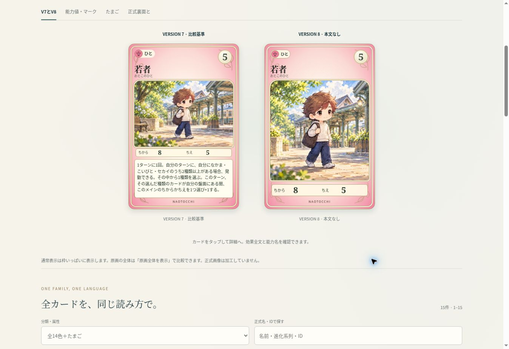
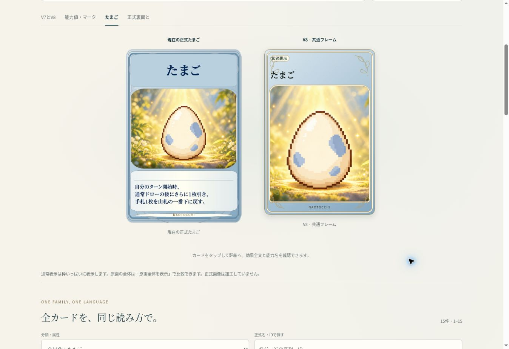
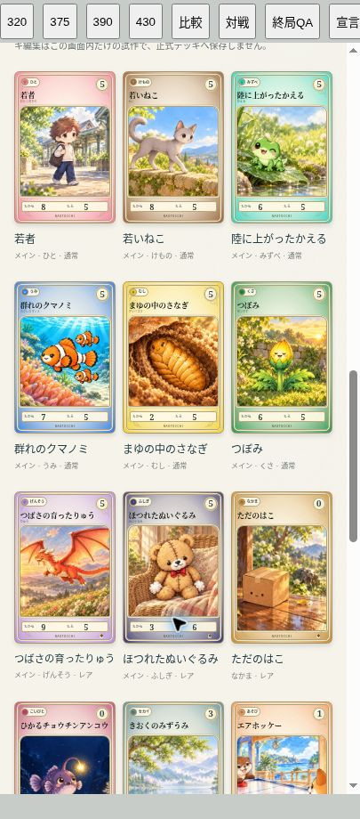

# カードデザイン VERSION 8 — 通常表示と詳細表示

**本人限定・未採用**。[VERSION 8](https://naotocchi-card-design-v1-20261114.kerzion214.chatgpt.site/v8/) ／ [対戦UI](https://naotocchi-card-design-v1-20261114.kerzion214.chatgpt.site/v8/battle.html) ／ [Draft PR #551](https://github.com/Naoto214/naotocchi/pull/551)

B3-A / V7改善版を継承。V1〜7の185ソースファイルと本人限定Siteの既存3592追跡ファイルを保持。main・本番GitHub Pages・PR #498は変更しない。

## 今回の結果

| 項目 | VERSION 8 |
|---|---|
| 通常表示 | 459枚＋状態表示のたまご、すべて本文・短縮文なし。空いた領域を大きなイラストへ。メインのみ能力値と補助名を残す。 |
| 詳細表示 | カード＋別の読みやすい本文欄。正式効果・能力名・発動条件・結婚時効果を省略せず表示。本文16px、行間1.85。 |
| カード名 | 正式form/nameを参照。背景枠・ルビなし、左寄せ・nowrap。実測して文字サイズを下げ、省略記号や途中切れを使わない。外側ラベルも同方式。 |
| 補助名 | 正式系列名、段階数字なし、淡い小文字を主名の実測高さの直下へ。 |
| 能力値 | イラスト直下に等幅2領域。「ちから」「ちえ」＋数字。数字はV7の5.5cqwから7.5cqwへ約36%拡大。Canvasの実字形boundsで光学中心を補正。 |
| 手・脳 | 初期表示は文字に統一。比較タブ・対戦UIでマークありを選択可能。正式SVG/コードは削除・変更しない。 |
| 非メイン | 能力値を追加せず、イラストを下まで広げる。菱形はrareのときだけ。 |
| たまご | 既存のpreserved-art.pngを再利用。正式の淡青色グラデーションに共通金枠・植物装飾・NAOTOCCHI。コスト・能力値・レア・カードIDは作らない。UIキーeggは検索用の状態識別子でデッキIDではない。 |
| レア・上限 | 菱形を維持。独立したversion付きpolicyを試作。全459枚で初期上限は正式ルールと一致。検証値1/2/3を変えても正式編集上限・rareは不変。 |

イラストは通常表示の広い枠を埋めるCSS coverが初期値。横長原画の左右が切れるため、同じページの「原画全体を表示」でcontainと比較できる。原画データは一切加工しない。正式な全体構図を重視するカードではcontainを選べる。全459枚に保存済みの大サイズ画像を用意する。詳細も同じ表示選択に従う。

## 画面と操作

- V7の現行カード／V8、文字能力値／手・脳あり、旧たまご／統一たまご、正式裏面を同じカードで比較。
- 全14色＋たまご、全459枚＋たまご、メイン248枚、追加7枚、長名・長文・レア・分類別の一覧。36枚ずつページ送り、3列固定。
- コレクション、メモリ内デッキ編集、40px手札、64px盤面を切替。デッキは現在の1/3枚制限と40枚総数で操作できるが保存しない。
- タップで詳細、全文、表裏反転、閉じる。正式名のみで検索。漢字候補はカードの表示切替から外し、名称監査資料へ移した。
- 対戦UIは正式engine/ui-session/presentation等32モジュールをバイト一致で別出力へコピーし、投影済み情報からカード表示だけを置換。選択・確認・戻る・確定・必須返却・応答・宣言・受け渡し・履歴・終局を扱う。正式盤面の幅・配置を維持する。
- この対戦UIはCPU・時計操作・保存・ルールブックの統合試験ではない。追加7枚はコレクションと詳細の比較対象で、正式452枚エンジンのデッキへ追加していない。対戦結果やデッキはブラウザの永続領域へ保存しない。

## 表示検証

Cloud Chrome実描画。320 / 375 / 390 / 430pxのiframe内容幅を確認。高さ844px。スクロールバー分15pxを外側に確保した検証ページを同梱。

| 検証 | 結果 |
|---|---|
| 全カード×4幅×3サイズ | (459＋たまご) ×4×3＝5,520件。名前のはみ出し・改行・ルビ・本文なし。コストとの縦重なり、補助名と絵の重なり0件。レア76枚、能力値248枚が原データと一致。 |
| 全カードの拡大寸法 | 296pxで全459枚＋たまご460件。主名・補助名・コストの重なりや横はみ出し0件。 |
| 全14色＋たまごのラベル | 4幅×15＝60件。分類ラベルと主名の重なりなし。外側の名前ラベルも省略なし。 |
| 詳細・全文 | 追加7枚×4幅、長いメイン名・最長メイン本文・長文こいびと・最長名・たまご×4幅の計48件。正式本文と一致。追加28件は表裏往復も検証。 |
| 能力値 | 実値1〜10。左右幅差最大0.015625px、全測定で字形metrics補正が適用。これはDOM幾何とフォント実測であり、V8の独立画像画素測定ではない。 |
| 対戦UI | 4幅で配置済み盤面を測定。極小相手カードも含め名前・コスト・分類ラベルの重なりなし。本文なし。手・脳切替とたまご詳細・反転を確認。 |
| 実操作 | 手札選択→たまご返却→応答パス→たんじょう、確認から戻る・再選択・確定。操作履歴の旧カード残り0。終局の引き分けと履歴表示。ヒット&ブロー宣言→戻る→同じ宣言を再選択→確定を確認。 |
| 上限試作 | レア「ただのはこ」を独立3枚設定にしても菱形・rare・正式デッキ編集1枚上限が不変。 |

**実機iPhone SafariとWebKitは未検証。** この環境で許可されたブラウザはChromeのみ。特にSafariのフォントfallback・小型文字の見え方は本人の実機確認が必要。

### 小型表示の限界

320px・3列の最長名「どこにもつながらないかいだん」は約5.69px。40pxの手札では約2.46px、64px盤面では約3.97px。省略や改行はしないが、小さい名前の可読性は詳細タップを前提とする。対戦の相手側は既存レイアウト由来の約10.7pxサムネイルもあり、カード面の文字は読書用ではない。外側の名前と詳細閲覧を利用する。小型数字も拡大時と同等の読みやすさを主張しない。

### 検証で修正した箇所

- 40px以下では固定1px枠が最小2px寸法を作るため、比率に応じたinset線へ変更。円を押し広げず金色の印象を保持。
- 分類タグをheaderの上端に固定し、対戦画面の本文line-heightによる下ずれを解消。
- 拡大キャンバスの旧0.5625倍transformを解除。実寸296pxで表示。
- 履歴・操作画面もV8のカードに統一。非公開情報は安全なprojectionからのみ参照。
- 終局時viewer/handがない状態に対応。宣言を戻した後も同じ選択肢を再選択可能。

## 正式14色

| 属性／分類 | 正式色 |
|---|---|
| ひと | #F17D9D |
| けもの | #95603C |
| みずべ | #27D3C5 |
| うみ | #2878E8 |
| むし | #F2D12E |
| くさ | #269451 |
| げんそう | #B58BE3 |
| ふしぎ | #35316E |
| なかま | #C68A32 |
| こいびと | #C04479 |
| セカイ | #568A9D |
| あそび | #EF9860 |
| あいてむ | #B7A48C |
| できごと | #9298A5 |

原色・属性マークはapproved-colors.mjs／正式iconから取得。濃色もB3-Aの中央が明るいグラデーションと暗い文字を維持。金色の二重枠・植物・角丸・ブランドは表裏の共通性を保つ。裏面のSHA-256は`028114e02034a5c5d84a0ace2c97babb92363e19eed6249f87cc591897189872`で不変。

## 名称の横断照合

[NAME-AUDIT.md](NAME-AUDIT.md) ／ [全件JSON](name-audit.json) ／ [漢字候補JSON](name-candidates.json) ／ [本人限定の閲覧表](https://naotocchi-card-design-v1-20261114.kerzion214.chatgpt.site/v8/name-audit.html)

31系列×8段階248枚のうち229名一致、19名差分（ヒトデ8・サクラ1・世界樹3・？？？7）。全19件を監査表に掲載。固定カード設計の保持という既存方針に由来し、自動修正していない。段階番号のずれ・ID未対応0。補助名31、なかま26、こいびと18は一致。「若者」は本編・図鑑・カードですでに漢字表記で一致。

正式カード識別名の重複0。進化formの同名はカード側10グループ、本編9グループあり、系列・段階・安定IDで区別する。旧cards.mjsにウスバカゲロウ①／現行アリジゴク①の差分1件も記録。

漢字候補14件（正式11・追加候補3）と本編への影響を掲載。正式名・読み仮名・系列・段階・キャラクターID・カードIDの共有registry案を提案。文字列をキーにせずIDを維持し、読みと検索aliasは表示名と別管理。正式改名・共通参照元への移行は承認後。本番変更は今回0件。

## レアリティと投入制限

[RARITY-DESIGN.md](RARITY-DESIGN.md)。現在はrare:booleanに1/3枚制限が結び付く。engine、デッキ編集・保存・インポート、CPUデッキ検証、UI説明を共通getDeckLimitへ集約する案。rare参照効果・CPU評価の意味は保持。保存はID配列のまま、将来超過時も黙ってデッキを変更しない。V8は独立policyの試作に限定。

## 再現と保護

```
node prototypes/card-game/design-comparison-v8-20261115/build.mjs /absolute/site/dist/v8
node prototypes/card-game/design-comparison-v8-20261115/verify.mjs /absolute/site/dist/v8
node prototypes/card-game/design-comparison-v8-20261115/qa-verify.mjs /absolute/site/dist/v8/data.json
node prototypes/card-game/design-comparison-v8-20261115/name-audit.mjs
```

PR551開始HEAD `c04688e468d40c507c81352ce559e9a1282dee49`、PR498読取HEAD `948026343099e34628f5655ae240d1083763ea9e`、本編名称監査main `408c72e6ebef71da3eab33cfb268c7494117aaaa`。正式452レコード・表示markup・CSS・918画像receipt・裏面・たまご原画・手/脳SVG・32 runtime modulesを照合。追加7枚は完成済み画像を再利用し再生成しない。正式色・効果・ルール・コスト・ID・能力値・CPU・時計・保存形式・正式投入制限の変更なし。

出力先が/v8であることを固定し、保存済みV1〜7とのbyte差分0を検証。すべての変更はこのV8ディレクトリ内と本人限定Siteのdist/v8のみ。

## 比較画像






