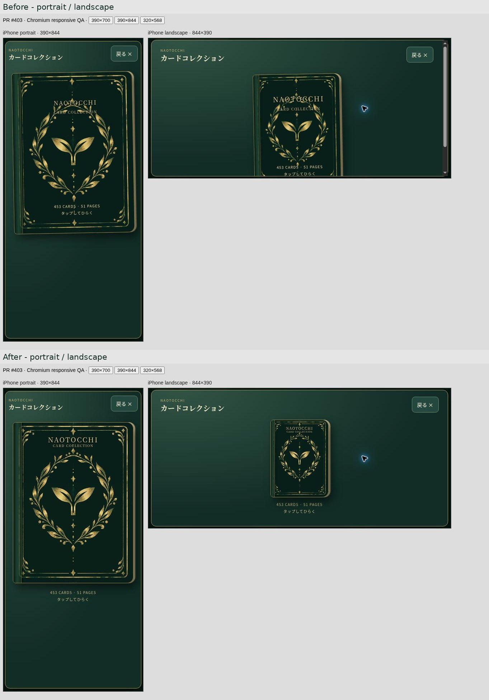
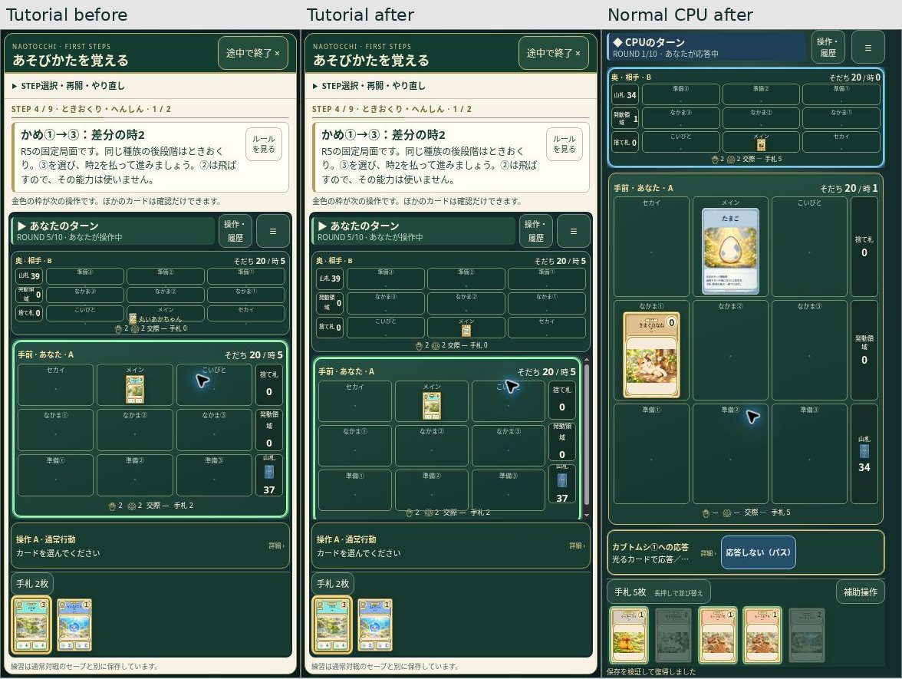
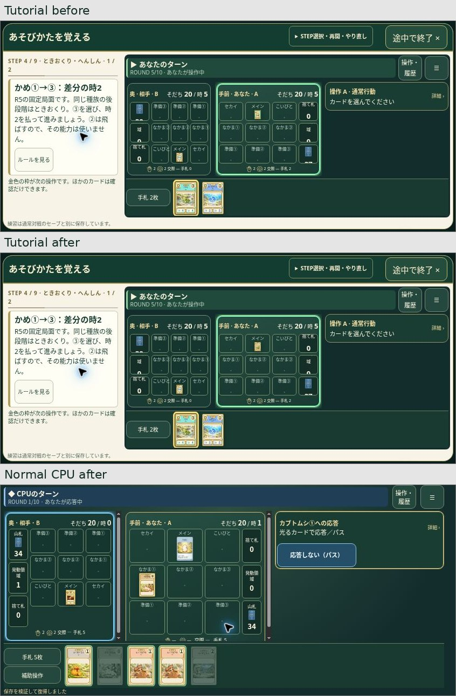
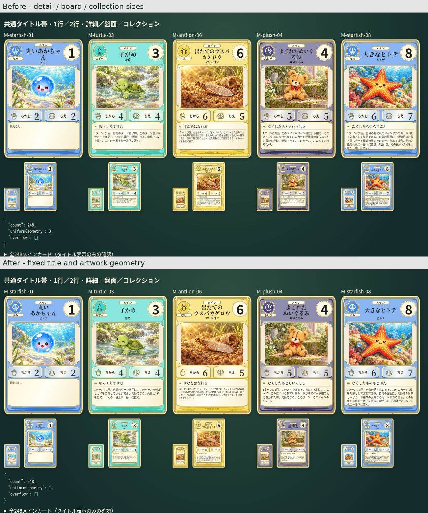
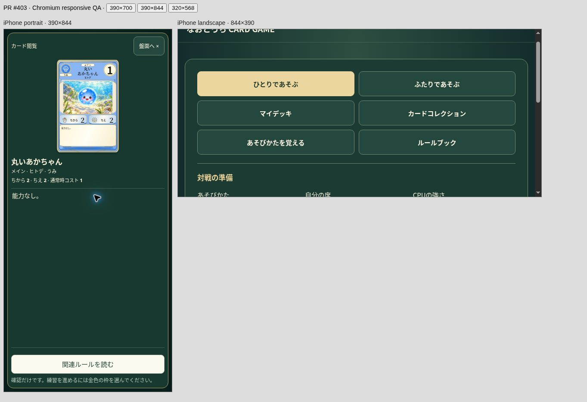
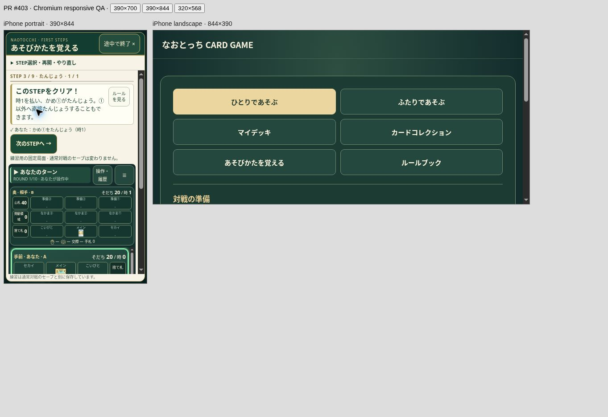
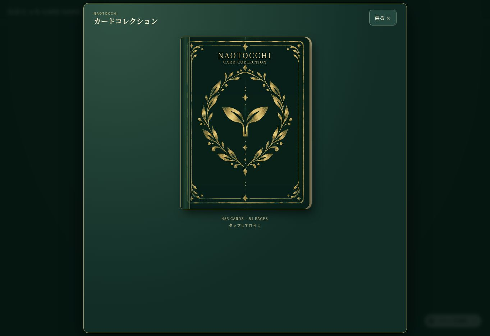

# PR #403 最終UI調整 検証記録（2026-10-20）

## 引き継ぎ

- GitHubから新規取得。既存ブランチ `feat/card-rulebook-tutorial-20261020` を継続。
- 開始HEAD: `8ca59fc6ad598ba99420a925200f307b2a6a9b3b`
- 開始tree: `e05eba89fa82a1dab632d54f76cad68b6949088e`
- remote main / PR base: `db9ea8e8d86c632a68ed8ab4880968803f78a243`
- PRはopen / Draft / unmerged。開始時48ファイルの既存差分を保全。
- `../qa-revision/verification.md` と `../handoff-revalidation/` の保存済み証跡を参照。
- 既存本人専用Site version 2、source `51ab968953cce7a310172597de7b70fea63e5bdd` を取得。959 runtime/assetsはGitHubの開始HEADと一致、残り1ファイルは既存root redirect。
- 開始時CIはPages runtime dependency auditがfailure、他3ワークフローはin_progress。新規依存と更新ハッシュを認めないPages allowlistの既存課題を維持。FUN_ITEMS監査不整合は別件。

## 変更範囲と原因

### 表紙

`collection-ui.mjs` と `collection.css` のみ。金色植物紋章・枠・背表紙・画像そのものは変更しない。
タイトルは上端14%＋paddingから8%へ移動し、左右12%の対称領域で中央揃え。画像内の上部装飾と中央紋章の間に配置。背景帯なし。
枚数／ページ数と「タップしてひらく」は表紙ボタンの外へ移動し、下中央に控えめな金色で表示。aria-describedbyで案内との関係を維持。
傾きの原因はCSS `rotate(-1deg)`。回転・hover回転と不要な親perspectiveを除去。元画像の厚み・陰影は維持する。
横画面はsvhから表紙サイズを決め、案内まで390px内に収める。

### CPUメイン枠

slot ID 1は元から中央列。問題は枠内のflex配置で、カードと重複カード名が左寄りになり、チュートリアルの110px盤面／22pxスロット補正が高さをさらに圧迫していたこと。
通常対戦・チュートリアル共通CSSでメイン枠内をsize container化し、カードの2:3比率を枠の幅・高さ双方に収めて中央配置。枠下の重複名称はメイン枠のみ非表示（カード詳細の名前とタップボタンのアクセシブル名は維持）。チュートリアル縦盤面を132pxへ戻し、22px補正を削除。
CPU側3×3の対面配置、正立画像、スロットID、正式状態、gameMarkup、チュートリアルの処理は変更しない。

| 環境 | カード中心−枠内中心 x/y（px） |
|---|---:|
| 修正前チュートリアル縦 | -43 / 高さ超過あり |
| 修正後チュートリアル 390×844 | 0 / 0 |
| 修正後チュートリアル 844×390 | 0 / 0 |
| 修正後通常CPU 390×844 | -0.0078 / 0 |
| 修正後通常CPU 844×390 | -0.0078 / 0 |

0.0078pxはサブピクセル丸め。画像と枠内の四辺の余白は対称。通常CPUの比較局面は正式エンジン・既存CPUポリシーで生成した合法保存データを通常UIから復帰し、実際の盤面を撮影した。テスト専用復帰fixtureは配信しない。

### メインカード名

静的専用アートではなく、共通HTMLタイトルの `overflow-wrap:anywhere` と名前長による可変サイズが原因。「丸いあかちゃ／ん」と分割されていた。
全メインカードを7.2cqw、行間1.13に統一。タイトル領域17cqwを確保し、1行・2行とも上下左右中央に配置。見出し内のカテゴリ4.5cqw／タイトル17cqw／種族4.7cqwの3段を固定。
表示専用の自然改行辞書を共通テンプレートに追加し、「丸い／あかちゃん」「出たての／ウスバカゲロウ」「よごれた／ぬいぐるみ」などに適用。正式カード名・ID・データは変えない。
248枚のメインカードを対象に、正式名の文字列一致、最大2行、2行目1文字の孤立なし、基本サイズ一致を検証した。これは文字組み検証であり452枚のアート再監査ではない。
同一240px幅で248枚のフォント・タイトル位置と高さ・イラスト・能力欄・効果欄・署名位置の組合せは修正前3種類→修正後1種類。タイトルのはみ出し0件。成長段階①〜⑧を全件検査に含め、①③④⑥⑧と長い名前を目視比較。
48pxの盤面相当／100pxのコレクション相当／240pxの詳細相当の共通描画を比較し、実際の詳細モーダルのタップ・表示も確認。小さいCPU盤面で本文全体の判読はできないため、既存どおりタップ拡大を維持。

## 実行した検証

- 差分＋関連単体テスト61/61成功。`focused-tests.log`。
- CPU policy/session・結果表示・履歴・応答コンパクト・現行裁定34/34成功。`regression-tests.log`。計95/95。
- 追加 `tests/ui-title-layout.test.mjs` は依存なしのNodeテスト。初回は変更前に2件とも失敗→実装修正後成功。レビューで一時JSDOMパス依存を指摘されたため除去し、61件を再実行して成功。
- 既存DOM検証6回成功: `learning.dom.mjs`、`tutorial-board.dom.mjs`、`collection.dom.mjs`、`menu.dom.mjs`、`my-decks.dom.mjs`（CPU／hotseat）。既存環境と同じ外部JSDOMを指定。
- 9STEP全完走、実カード操作、CPU応答、誤操作拒否、学習セーブ分離、休止・再開、nested help、通常対戦保存復帰、非公開手札保護、453コレクション／お気に入り／表裏、マイデッキを既存DOM回帰で確認。
- Chromiumの実iframe viewportで390×844／844×390を確認。320×568および390×700への高さ変更、復帰時のSTEP3完了状態保持、横はみ出しなしを確認。
- reduced-motion既存CSSを保持。今回の表紙回転・transitionを除去し、新規アニメーションは追加していない。OS設定を切り替える実機検証は未実施。
- 独立コードレビュー完了、指摘した追加テストの可搬性を修正済み。
- `git diff --check` 成功。既存追跡ファイルの差分はUIの5ファイルのみ。その他の追跡ファイルは開始HEADと一致。
- 全452アート、カード定義・数値・効果、正式ルール、Python、CPU判断、response/chain、自動パス、保存schema、固定400戦、本編・なおぽよ・Character／World 3D、他PR、Pages設定は変更していない。400戦や既知失敗の全件監査は再実行していない。

## 残るiPhone Safari実機QA

この証跡はChromiumであり、本人のiPhone Safariの代替ではない。縦横回転、Safariバーの実際の開閉、safe area、アプリ切替後復帰、実タッチでのメイン詳細、OSの「視差効果を減らす」を最終確認する。
実機で表紙の上部装飾／植物紋章の間隔と小型CPUメインの視認性も確認する。

## 保存・試遊版

GitHubは既存PRブランチへ保存し、Draftを維持。mainマージ・本番GitHub Pages更新は行わない。
同じ本人専用URLの更新成功（owner-private維持）: https://naotocchi-learn-20261020.kerzion214.chatgpt.site/
公開結果・実装HEAD/tree・Site版の対応は `publication.json` に記録する。最終証跡コミットはこの記録を加えるだけでruntimeは同一。
配信960ファイル／141,520,412 bytes、959 source/assetsがGitHubとバイト一致、root redirectは従来どおり。詳細は `runtime-integrity.json`。

配信後にも通常メニューから表紙を開き、transform:noneとcaptionが表紙外にあることを確認。

実装コミットのPages CI job `118662529164` は既存のlearning-ui.mjs / rulebook-content.mjs / learning.cssのallowlist未登録で失敗。deployはskipped。本番Pagesへの公開はない。その他CIは公開記録時点で実行中。
