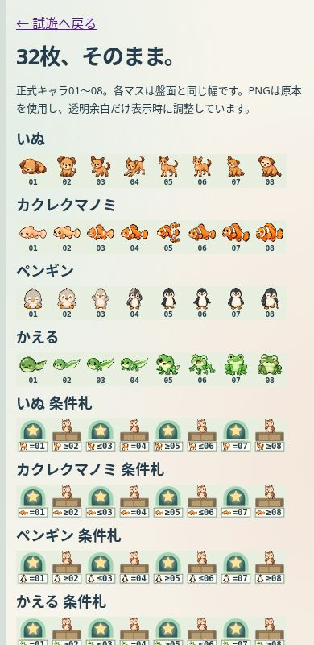
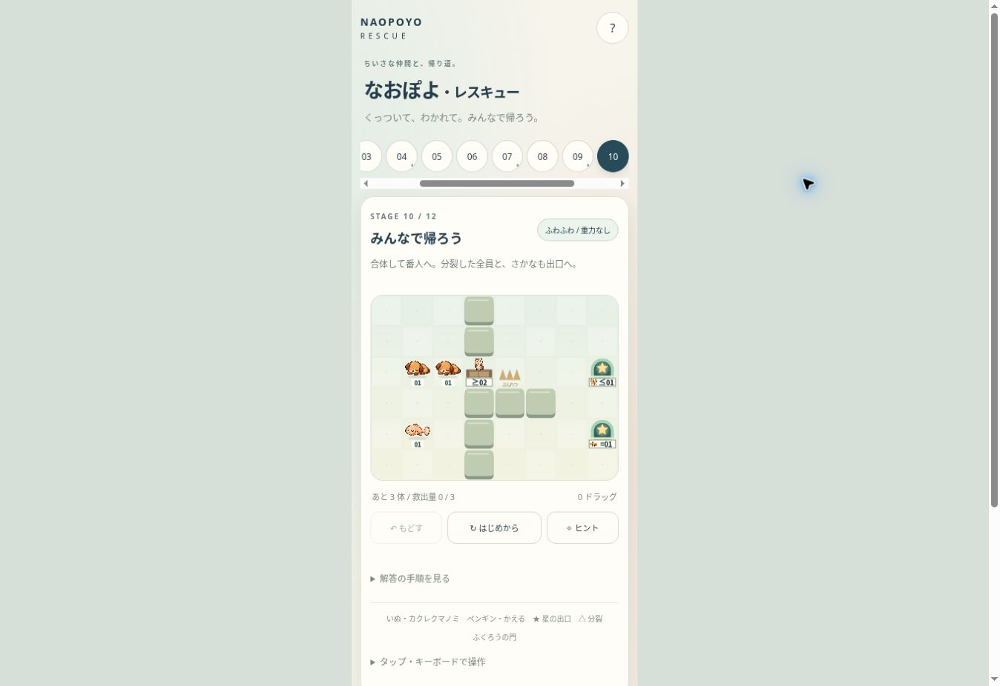

# 正式キャラ・番人必須通路 改善報告

2026-10-21 / PR #412。起点20aa647dbe705bd09eef34e14b673e320a4cd474。開始時のremote mainは79d59aece7c91d52387345da737354927df7dc8f。起点PR CIは4件成功。今回の変更はprototypes/naopoyo-rescue配下のみ。

## 表示

| 採用 | 原本パス | 対応 |
|---|---|---|
| いぬ | assets/characters/dog/01.png〜08.png | 8/8 |
| カクレクマノミ | assets/characters/clownfish/01.png〜08.png | 8/8。保存の内部ID fishを維持 |
| ペンギン | assets/characters/penguin/01.png〜08.png | 8/8 |
| かえる | assets/characters/frog/01.png〜08.png | 8/8 |
| ものしりふくろう | assets/characters/companions/owl.png | 閉門・開門・通過中 |

PNG原本は変更なし。透明画素の境界＋2pxをCanvasのsource rectangleとして読み、縦横比を維持。陰影と合体/分裂時の伸縮は表示側のみ。種族の輪郭・色を再描画しない。公式出典とhashは既存 docs/naopoyo-rescue-design-20261021/source-manifest.json を再利用。今回33枚のhash結果は evidence/official-assets.json。

出口は丸い星アーチ。番人は角形門と正式ふくろう。開門後は門扉が左右へ退き、緑の通路を表示。条件札Aは下部に種族06の正式アイコン・比較記号・2桁数字。段階のみ/種族のみ(ALL)/組合せに対応。操作キャラが門上にいると、番人を左上、操作キャラを右寄り、操作キャラの段階を右上へ分離。

## ステージ

| 面 | 変更 | 解答 |
|---|---|---|
| 01〜06・08・09 | 地形/初期配置/解答は維持。08の色頼みの説明だけ種族アイコンへ変更 | 全面成功 |
| 07 | x=3の縦壁、y=2の門のみ通れる。02で開門→01に分裂→出口 | 旧解答維持 |
| 10 | 同じ縦壁＋既存横壁。いぬの開門後に魚も同じ門を通る | 魚の操作列を変更 |
| 11 | ペンギン03+03→04で開門→トゲで03。残った子はトゲを避ける上の帰路 | 追加・成功 |
| 12 | かえる02を先に01へ分裂→≤01で開門→向こうで02へ再合体 | 追加・成功 |

solutions.jsonに全12面の実操作列を保存。移動ごとの総量保存、合法性、状態検証、指を離した時の重力、最終全員救出をテスト。move/releaseの処理は無変更。全員救出以外の新しい勝利条件は追加していない。

## 閉門探索

実エンジンmove/releaseを使い、番人の種族条件だけを到達不能の専用値へ設定。required勝利フラグは無効にして、地形で通れないことを検証。全方向の移動とreleaseを列挙し、実際のUIより自由な操作順序も許す上位集合を探索。IDのみ違う同配置を同一視する。上限100,000に達した場合はlimit（未証明）を返す。

| 面 | 全探索した状態数 | 結果 | 最大救出量 |
|---|---:|---|---:|
| 07 | 171 | exhausted / 閉門では不可能 | 0 |
| 10 | 2,754 | exhausted / 閉門では不可能 | 0 |
| 11 | 171 | exhausted / 閉門では不可能 | 0 |
| 12 | 170 | exhausted / 閉門では不可能 | 0 |

探索上限に達した面なし。旧07の壁なし地形では探索が実際に迂回クリアを発見する陽性対照も実施。重力処理も探索遷移に含むが、今回の番人4面は重力なし。重力のある09は実解答とブラウザで検証。

## 保存互換

キーnaopoyo-rescue-v1・version1・fish ID・clearedを維持。旧07/10の正規地形を持つ途中状態とUndoは、そのまま旧地形で継続。「更新前の途中データを継続中」と案内し、はじめから/ステージ選択時に新地形へ切り替える。旧10の魚ルートはlegacy-solutions.jsonを使用。任意改変地形のセーブを受理する緩和はしない。

## 検証

- `node --test prototypes/naopoyo-rescue/tests/*.test.mjs`：127/127成功（evidence/art-tests.log）。
- 正式32枚＋ふくろう1枚のSHA256一致。描画範囲はalpha bboxを全て含み、タイル内に収まる。
- Cloud Chromeの390px iframe、盤面336px・1マス42pxで確認。
- 07の連続ドラッグ合体/開門/分裂/全員救出、開門後の再読込復帰、Undo、リトライを実操作。
- 11・12の全員救出をドラッグで確認。09はタップ・矢印・指離し相当・ドラッグで足場と全員救出を確認。
- 旧07の途中セーブが初回読み込みでそのまま復帰、リトライで新通路へ切り替わることを確認。
- art-check.htmlで32枚・01〜08条件・閉門/開門/占有表示を確認。全33枚の読込完了。
- 独立コードレビュー：Critical/Importantなし。既存ゲームへの非干渉は変更パス限定とエンジン差分で確認。リポジトリ全体テストは実行しておらず、全体合格とはしない。

## 試遊と残課題

更新先は既存本人限定URL： https://naopoyo-rescue-20261021.kerzion214.chatgpt.site
デプロイID・GitHub最終HEAD/treeはPR本文と最終報告に記載する。

iPhone Safari実機は未確認。確認してほしい項目：指の追従と連続操作、門上のふくろう/キャラ/数字、条件札の=・≥・≤と種族、低段階キャラの識別、回転/バックグラウンド復帰、Undo/リトライ、12面クリア。

軽微な残課題：通信失敗時の画像エラー案内は操作で消えることがある（画像が欠けた場合は再読込）。救出の短い光輪は複数出口の面では全出口に出る。旧セーブ継続中は旧地形の迂回性も維持されるので、新しい通路のQAは「はじめから」で行う。

mainマージ・本番Pages・旧ドロップ/スライド/入れ替えの変更なし。正式採用は本人のiPhone確認後、レスキュー本体の小規模マージを別承認で進める。導線切替はさらに後続の小さな変更とする。
