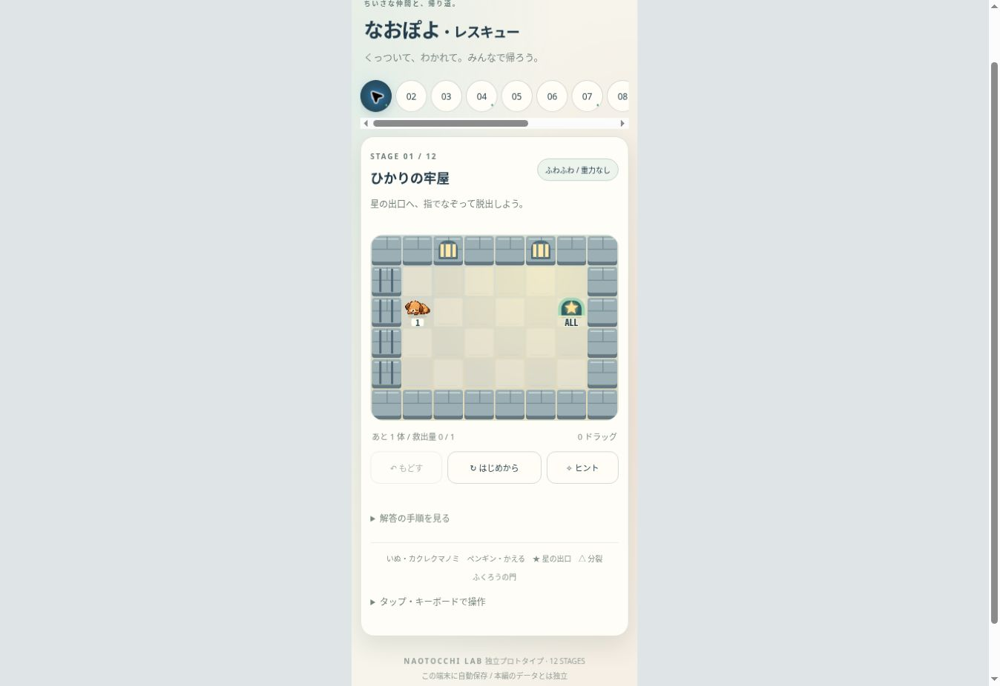

# 8方向移動・個別通行・牢屋テーマ 改善報告

2026-10-21。PR #412 / 起点 HEAD 9a4b384e0237a375d1309175da0187328005e62a、tree 05a205f38500dd68c92d00990cb3dd858a7c3f23。最新remote内容をAPIから同期して作業。開始CIは3成功、Home layout実行中。変更範囲は prototypes/naopoyo-rescue/ のみ。

## 実装

- エンジンが8方向の隣接移動に対応。斜めの門・出口・トゲ・合体も同じ処理を通る。
- 斜めの両脇セルに壁／条件不一致の門があれば角抜けを拒否。仲間は地形とは分離し、09の足場を維持。重力上昇条件は従来の足元＋隣接足場を要求。
- 実ポインタ座標をセル境界で補間。斜めで同時に境界を越える場合は斜め1手。coalesced eventsが空のブラウザにも対応。障害物接触後も全経路セルを同じ方法で処理し、直線経路を100分割した場合と1イベントの場合で実エンジンの結果が一致。
- 門は通るキャラの種族と段階を毎回確認。保存上の既存openフラグは通過履歴として維持し、許可には使用しない。合体後の段階で門をだますことも不可。開門アニメーションはWeakMapの非保存イベントに分離、占有中を除き約440ms以内に閉じる。
- 成長表示・条件・遊び方を1〜8に統一。正式画像の01〜08、内部値、保存version1/キー、ステージIDは維持。
- 条件の白枠を廃止。正式種族アイコン＋記号＋1桁数字を配置、薄い文字縁取りだけを使用。ふくろう・星アーチ・星・条件種族画像を表示側で拡大。PNG原本は変更なし。
- トゲ下の「ぶんれつ」を削除。分裂位置は進入マスと直前マス、操作は進入側を維持。
- 01「ひかりの牢屋」：石壁、格子、小窓、柔らかな光、石床。外周壁は実際の衝突セルと一致。中央の簡単な移動→脱出は維持。themes.mjsが表示を担当し、ゲームロジックは2D。
- 10は魚1専用の第二の門を追加。犬の合体→門→分裂、魚の帰路を両立。全員が門を通る構造を維持。

## 保存互換

既存v1のキャラ・救出量・Undo・クリア済みを保持。旧10の認識済み地形には魚の門を追加して該当壁だけ除去。新しい門の位置に既存キャラがいた場合は通過履歴を付け、再保存後も復帰可能。任意の改変地形を受け入れる緩和はしない。旧01や初期07/10の途中状態は従来地形のまま継続し、「はじめから」で最新の地形へ。旧地形の迂回性は互換維持のため残るので、新しい番人通路の試遊は必ず「はじめから」で行う。

## 検証

- `node --test prototypes/naopoyo-rescue/tests/*.test.mjs`：139/139成功。evidence/eight-way-tests.log。
- 全12面の solutions.json を実エンジンで再生。各移動の合法性・総量保存・状態検証・落下・全員救出を確認。10の魚解答だけ変更。
- 8方向の閉門探索：07 171状態、10 2,754状態、11 171状態、12 170状態を全探索、すべて救出量0、探索上限到達なし。旧壁なし07で迂回を見つける陽性対照も成功。evidence/eight-way-passages.json。
- 公式32PNG＋ふくろうのhash/表示範囲テスト成功。原本画像変更なし。
- Cloud Chrome・390px iframe、約42pxセルで確認。01の斜めドラッグ→斜め脱出、Undo、再読込復帰。10の連続合体→通門→分裂、残った子と魚の救出、3ドラッグで全員脱出。09の足場・上昇・指離し相当・全員救出。
- 独立コードレビューで旧セーブ占有位置と入力イベント分割の2点を検出し、失敗再現テスト後に修正。再レビューで両修正を確認、残る重要指摘なし。
- リポジトリ全体テストは未実行。独立プロトタイプの検証であり、本編全体の合格とはしない。

## 実機QA・残課題

iPhone Safari実機は未確認。指の追従・高速/低速なぞり・斜めの門/出口/トゲ・小さい数字と種族の視認性・回転・バックグラウンド復帰・Undoを本人確認。

ブラウザが報告しなかった曲線の形状は復元できないため、速度非依存は同じ観測経路／同一直線のイベント分割について検証。閉門探索は新規開始の地形が対象。

従来の軽微な残課題：画像読込エラー案内が操作で消える場合、複数出口の救出光輪が同時に出る場合は継続。ステージ番号01〜12と内部画像IDは今回の成長表示変更対象外。本編・旧作品等の横断数字表記調査は今回実施せず、将来候補とする。

本人限定の既存URLを更新し、owner1名・外部共有0を保持。mainマージ、本番GitHub Pages、旧ゲームの変更なし。正式公開はiPhone確認後の別承認。
