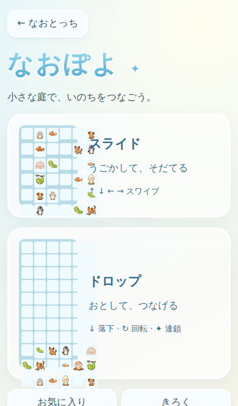
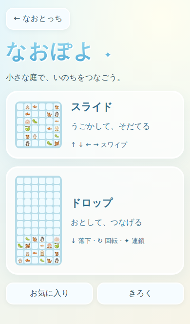
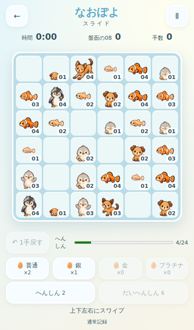
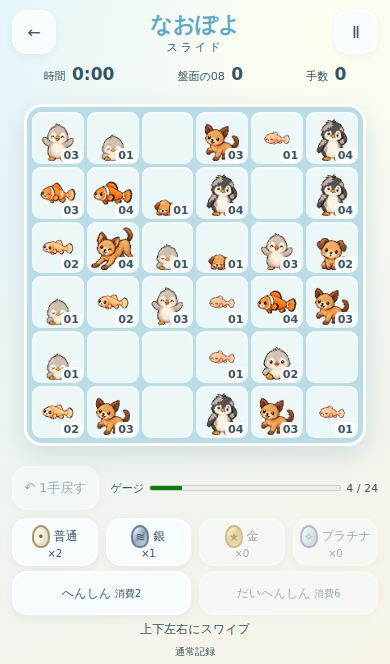

# iPhone UI修正検証（実機Human QAは未実施）

Draft #386。現行ルール・旧証明・本編save/schema・ドロップ・画像資産は変更していません。

|報告された問題|修正|検証|
|---|---|---|
|入口プレビューがカード外へ伸びる|明示寸法/均等grid、画像absolute、min-size解除|390/375/430/667/844幅でセルの正方形と枠内包含|
|空き/キャラセルが伸縮|6行6列minmax(0,1fr)、盤面幅高さ同値、画像absolute|画像1200×800を指定/半数除去しても寸法一致|
|移動が一瞬|元座標から移動先へアニメーション。200/240/280ms選択、標準240|座標mappingテスト、既存入力競合テスト|
|卵が全部白|普通=クリーム点、銀=縞、金=星、白金=菱形、名前表示|4種類CSS/画像確認。既存画像は不変|
|費用が不明|現在/上限と「消費2」「消費6」を分離|DOMと画面確認|
|横画面で収まらない|表示可能高さ/visualViewportに追従、盤面左/道具右scroll|667×320、844×390の盤面/主要操作包含|
|保護項目|外周投入、殻割れ、進化/連鎖、Undo/保存/記録分離を維持|既存DOM/races/証明・資源整合性テスト|

専用を含む52テスト、既存mutation engine15/player8/balance7成功。追加レイアウトmutationは縦/横トラックの不均等化を各viewportで検出するもの。全体回帰は既存npm testのnode test concurrencyのみ2へ制限し3144+80全成功、smoke/dialogue/visual QA成功。既存証明87+147、matrix320/policy120/additional480の再生一致。

GitHub Actionsの`naopoyo-slide-browser`にbefore/afterを保存。beforeは正本b8fad706を同じChromium/viewportで再描画した比較画像で、ユーザーのiPhone実機写真ではありません。after-entry、after-board、after-eggの各375/390/430/667/844幅。通常画像と卵投入画面を目視確認。入口の枠外プレビューは同条件で再現しました。Safari実機で報告されたマス伸縮はChromium初期画面では必ずしも再現しません。before/afterの盤面seedはランダム選択で異なるため、配列や難易度の比較には使えません。

ブラウザ自動検証はChromiumのモバイル相当サイズです。iOS Safari実機とは区別します。横画面の卵投入では盤面が小さくなります。読める文字/狙いやすいタッチ領域、Safariバーの挙動、速度の心地よさはHuman QAで未確認。正式マージ前に判定してください。

ルール比較は独立Draft #387。このUI修正だけを採用するか、未採用の比較設定をどう扱うかは別判断です。今回はどちらもmainへマージしません。

## 保存した代表画像

|画面|修正前|修正後|
|---|---|---|
|入口390幅|||
|盤面390幅|||

横画面：[通常844幅](qa-evidence-20261015/after-board-844.png) / [卵投入667幅](qa-evidence-20261015/after-egg-667.png)。CI run38712857538で全成功、トラックmutationは2種類×5viewportを検出。

## 2026-10-16 JST 再開確認

製品コード不変。52テスト、engine15/player8/balance7 mutation、player DOM/racesを再実行して成功。remote/localのd4fdafeb/tree ed14b443一致・cleanを確認した。最終コードのCI run38713684499（画面検証を含む）とrun38713684457（npm test全体）のsuccessを再取得確認。今回のChromium起動は環境のsocket権限制限で失敗したため、同一コードの成功CIと既存画像を再利用する。実機Human QAは未実施。計画書の未更新チェック欄を成果に合わせて更新し、文書のみ追加保存する。#386/#387ともDraftを維持し、main・本番は変更しない。
