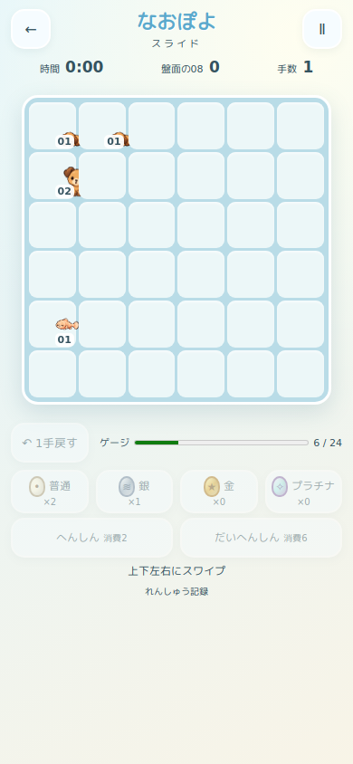
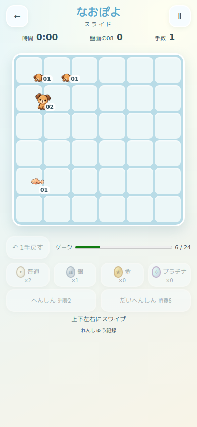
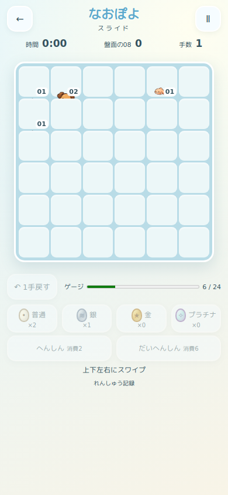
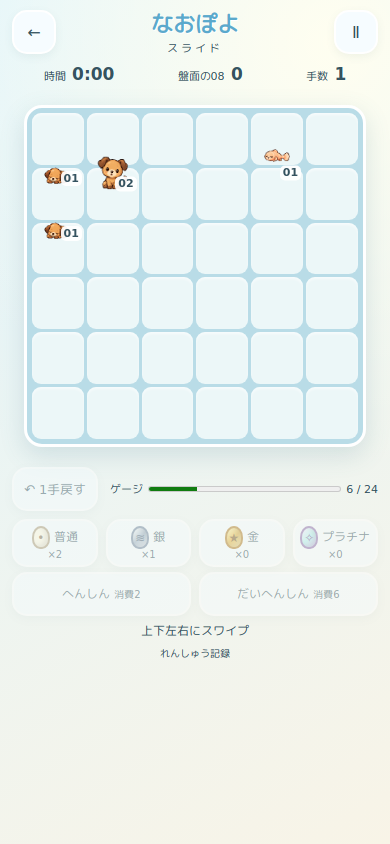

# PR #386 描画修正・再監査チェックポイント

開始時main: `2cf0570ab801d389c42af560d323ff643c69a220` / tree `33c851c361c524e509a0ed8cd80a058d2566ae3d`。
PR #386起点: `607275a5632491f12752a7374bb002a48e5cfce8`。
mainの#388・#389を取り込んで検証。#387は `0f979b0179f5e47578d52ce1ce8776b75ca00b1f` のDraft/open/未マージを保持。

## 原因と修正

旧実装は移動先button内のimgだけを元の位置からtranslateしていた。後続buttonの不透明背景が同じ描画順に存在するため、左・上方向でキャラを覆った。固定pxの移動距離は、途中回転時に新しいセル寸法と一致しない。また進化のtransform/filterをbutton自体に掛けると、セル単位のstacking contextになる。

- boardを独立した描画範囲にする。セル背景は通常描画順、全キャラの`.tile`は共通のz=1。セルにはstacking contextを作らない。
- 画像と段階表示を同じtile内に置き、両方を同時に移動する。画像の寸法はセル内に固定したまま。
- セルのoverflowはvisible、盤面外だけ従来どおりclipする。飛行卵は従来のz=5を保持。
- 進化・消滅の拡大/発光はtileに適用し、背景の描画順に影響させない。
- 移動を`セル数×100% + セル数×gap`で表し、240msの途中に画面サイズが変わっても新しいセル寸法へ追従する。方向別の例外処理なし。

## 実ブラウザでの描画

`tests/paint-order.cjs`は本物の保存復帰・スワイプ・Web Animationsを使用。テスト側でアニメーション時刻を固定し、以下を4方向で確認した。

|フレーム|画面|時刻|
|---|---|---|
|開始|390×844|0ms|
|中間|390×844|120ms|
|回転後中間|844×390|120ms|
|小型横画面中間|667×320|120ms|
|縦へ戻した中間|390×844|120ms|
|終了直前|390×844|239.999ms|

続けて240msの終了を実行し、2段階の進化/連鎖後の盤面がエンジン結果と一致することを確認。4方向×6=24フレームで、複数キャラが3〜5マス移動する。

判定はDOMだけではない。実際の盤面PNGと、同一フレームのキャラを背景より確実に上へ描画した参照PNGが一致することを検証。busy中の背景はpointer-eventsが無効なので、hit-testだけでは不透明背景を検出できないことも踏まえ、画素の一致を必須とした。位置誤差1px未満、正方形セル、画像読込、表示240msも確認。

元HEADの実CSS/JSをルーティングした再実行は、左・上の中間画像の不一致、回転時のずれ、進化時のセルcontextを検出して不合格。修正後は24フレーム全成功。`paint-mutation.cjs`の前景z削除・セルcontext導入・セルclipの3故障も、各24フレームの画素不一致で検出した。

画像・JSON・ログ: [qa-paint](qa-paint/)。同じ盤面/時刻の比較:

|方向|修正前|修正後|
|---|---|---|
|左|||
|上|||

Chromium 131の端末相当サイズ。ローカルは同梱Rounded MplusをOSフォントとして使用。iPhone Safari実機ではない。

## このチェックポイントで完了した回帰

- スライド専用52/52、DOM/races成功。既存テストの削除・緩和なし。
- 既存mutation: engine15/15、player8/8、balance7/7。追加描画mutation3/3。
- 既存証明87+147件、matrix320・policy120・追加480件の再生一致。再測定・ルール変更なし。
- レイアウト5サイズ: 390×664、375×667、430×740、667×320、844×390。入口・正方形・画像内在サイズストレス・卵選択・縦横トラックmutation10件。
- 操作4サイズ: 375×667、390×844、414×896、430×932。シリーズ入口、お気に入り、スワイプ、道具、解法全手再生、Undo確認/取消、保存復帰、練習/通常記録、新ドロップ起動2/6、本編保存保護。JSエラーなし。
- 新ドロップ43/43、旧ドロップ130/130。保存互換6シナリオと通常/比較/旧/スライド記録分離が成功。
- mainとのdiffでエンジン・保存・証明・新旧ドロップ・本編・図鑑・3D・カードを変更していない。詳細 `qa-paint/protection.json`。
- 独立コードレビュー: Critical/Important指摘なし。追加Chromium確認で非reducedの卵飛行中間の重なり・孵化完了、スライド途中pauseの完了処理とbusy解除が成功。

## 最終ゲート

このファイルを保存する時点で全体`npm test`は実行中、更新後CIはこれから実行する。成功扱いにしない。最終CI・全体回帰・マージSHA・Pages公開ファイル照合結果は[PR #386](https://github.com/Naoto214/naotocchi/pull/386)の最終監査欄へ記録する。必須項目が失敗した場合はDraft/未マージを維持する。

iPhone Human QAは未実施。縦横の4方向スワイプ、移動途中回転、Safariバーの伸縮、卵外周投入・連鎖、Undo/保存復帰、240msの体感を確認する。#387の補充案の採用・バランス完成判定は行わない。
