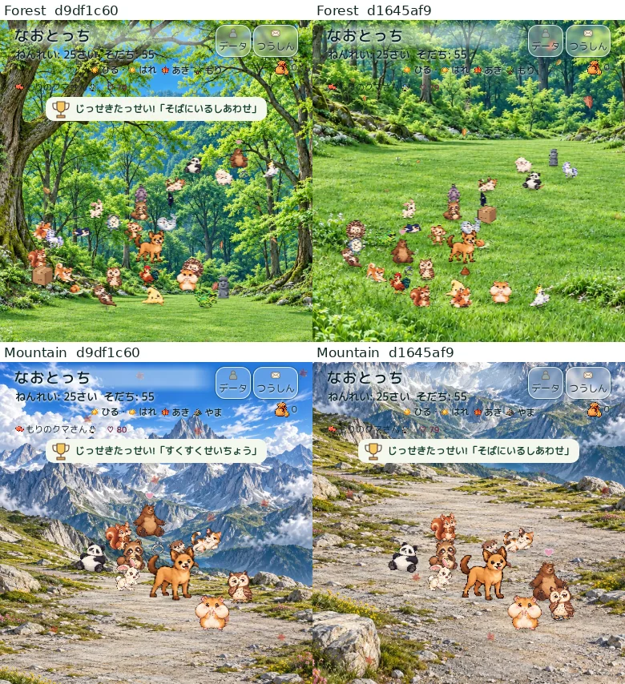

# Portrait ground and resident shape

The comparison image shows the first 402 CSS pixels of the 390×630 forest and mountain homes. The left column uses the d9df1c60 runtime. The right column includes the paired seats and the d1645af9 ground crop. Both use the same production daypart files, character PNGs and saved household. The browser loaded the production entry with 28 forest or 10 mountain residents. The capture held model movement to compare opening placement.

The earlier forest paint covered the screen independently of the camera that positioned residents. Its shadow sampler classified 3 of 28 feet as clearing and 25 as uncertain. The screenshots show residents against actual branches. On the corrected 390×630 forest screen all 28 feet clear the treeline. The camera also places the mountain group below the rocky trail edge.

The 390×630 forest uses a uniform 594.1×891.2 CSS-pixel image in the walking pane, horizontally centered with its top at −335.5. Its zoom is 1.415 times the earlier 420×630 cover. The corresponding mountain zoom is 1.121. On 390×844 the ratios are 1.615 and 1.281. The remaining foreground of the same image fills the controls below the pane. It begins four pixels past the resident viewport and can stretch vertically by up to 1.4 times. Both pieces meet at the same source-image row. The cast, its shadows, the foreground mask and the painted-ground sampler all use the uniform part. Screen-height differences still affect how widely the original companion seats spread vertically.

For each actor the probe recorded the native image dimensions, transformed image rectangle, model foot in screen coordinates and actual shadow rectangle. The lower painted edge uses the bottom of the source PNG's alpha bounding box at a threshold of 32, scaled into its image frame. In the four settled Chromium captures the maximum distance from this edge to the model foot was under 0.09 CSS pixels. Shadow centers were within 0.03 pixels. The 128×128 frames ranged from 1.01004 to 1.01011 in width-to-height ratio during the normal idle pose. The stone figure and cube in the crowded forest are the existing sekizou and box companion images. The tall-screen forest night capture did not retain the draw-call coordinates in its probe turn. Its screenshot, contact samples and displayed foot coordinates were recorded.

[Per-viewport observations](./portrait-ground-captures.json)

The 375×667 WPE WebKit startup also exposed a separate paint-order defect. While the camera waited for its new ink and terrain bounds, the frame took on different horizontal and vertical scales. Its residents still had the previous scalar scale and the canvas still displayed the earlier crop. Twelve samples remained on that first simulation frame over at least 14 seconds on the loaded runner. A zero-time redraw and inverse resident scaling in the camera update corrected both on the same simulation frame. The WebKit observations capture the pending phase independently of the final opening-seat selection.

[WebKit pending-fit measurements](./portrait-pending-webkit.json)

With deferred household seating enabled, the native owner launcher also ran at 320×516 in Chromium and 375×667 in WPE WebKit. The forest 28 and mountain 10 ready captures in both engines showed a visible cast with matching camera and canvas revisions. The Chromium sync observer also recorded the provisional cast hidden on each case. The WebKit sync samples did not capture that intermediate visibility state. The four sampled dog/bear pairs had image-box ratios between 1.00 and 1.011. In the 375px forest opening, both feet were at 73.35% of the actual image height and the browser screenshot showed the bear beside the dog on the grass. These opening observations retain their sampled simulation clock and exact source hashes.

[Combined opening measurements](./portrait-combined-opening.json)
